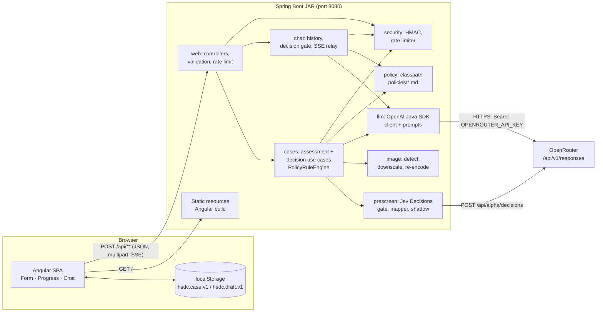
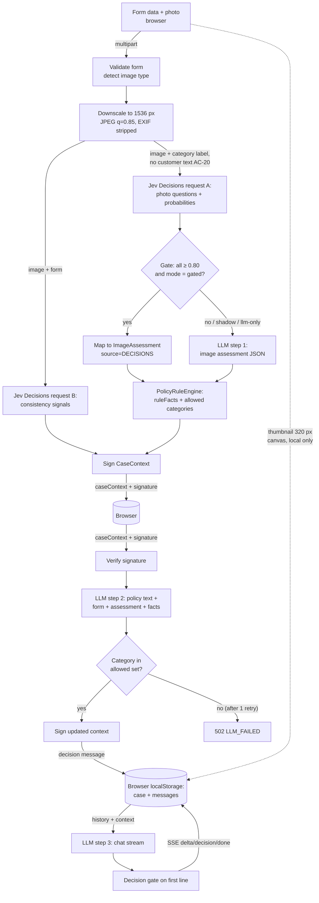
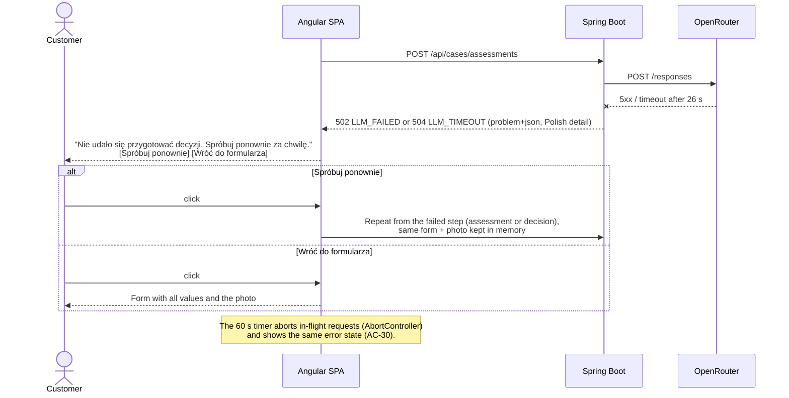
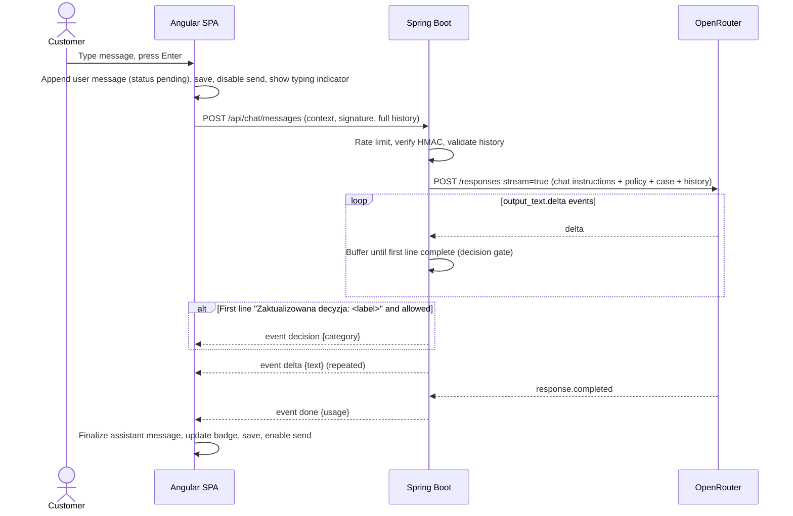
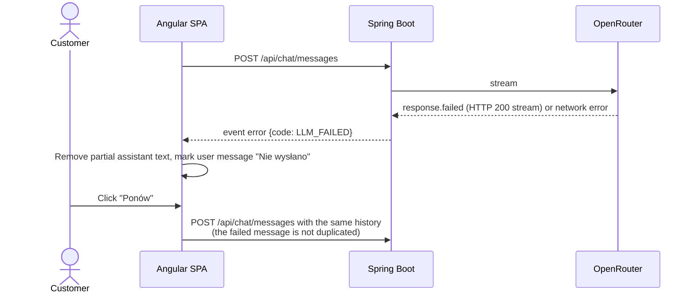
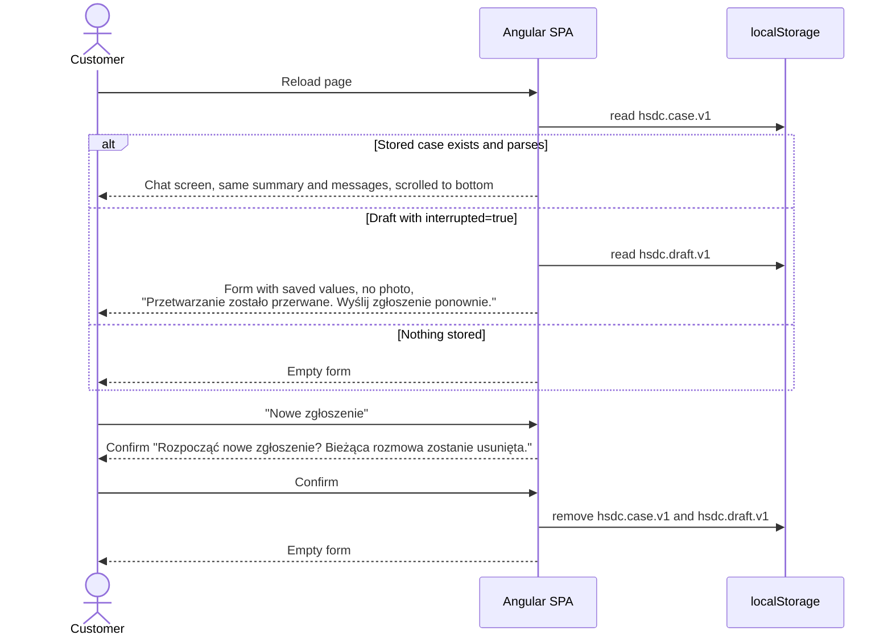

# ADR: Hardware Service Decision Copilot — Main Architecture

**Date:** 2026-11-25
**Status:** Accepted
**PRD:** [`docs/PRD.md`](../PRD.md)

Area ADRs:

| ADR | Area |
|---|---|
| [`001-backend-api.md`](001-backend-api.md) | Spring Boot backend: project setup, REST/SSE API, validation, image processing, rate limiting, packaging |
| [`002-llm-integration.md`](002-llm-integration.md) | OpenAI Java SDK + OpenRouter Responses API: image assessment, decision, chat streaming, prompts, guardrails |
| [`003-frontend.md`](003-frontend.md) | Angular + Angular Material: project setup, screens, chat UI, streaming client, browser persistence, theming |
| [`004-decisions-prescreening.md`](004-decisions-prescreening.md) | Photo pre-screening with `typesafe/jev-1.14` (OpenRouter Decisions API): confidence gate, shadow/gated modes, consistency signals |

---

## 1. Overview

The PoC is a self-service web application in which a customer of the fictional shop "ElektroDemo" submits a return (**Zwrot**) or a complaint (**Reklamacja**) with one photo. The system:

0. pre-screens the photo with a decision model (`typesafe/jev-1.14`). The model answers typed questions about the photo with probabilities, and checks the form against the photo for consistency (ADR-004),
1. assesses the photo with a multimodal model (structured JSON, no decision). In `gated` mode this step is skipped when every pre-screening answer has confidence ≥ 0.80,
2. lets a reasoning model apply the matching policy (`docs/policies/*.md`) and write the preliminary decision in Polish,
3. continues the conversation in a streamed chat that can update the decision.

This ADR set turns the PRD into implementable technical decisions: stack, repository layout, API contracts, LLM integration, browser persistence, guardrails and the test strategy. The PRD stays the source of business behavior; acceptance criteria are referenced as `AC-xx`, technical acceptance criteria introduced here as `TAC-xx`.

Decisions confirmed with the user on 2026-11-25:

| Topic | Decision |
|---|---|
| Repository layout | One Maven build; Angular frontend built into the Spring Boot JAR |
| Java | Java 25 (LTS) |
| Models | Two env variables: `LLM_VISION_MODEL` (photo) and `LLM_MODEL` (decision + chat) |
| Streaming | SSE over `POST` (`text/event-stream` response), consumed with `fetch` in the browser |
| Deployment | Local run with Maven wrapper + one multi-stage `Dockerfile` |
| Frontend tests | Vitest (unit) + Playwright (E2E) |
| Browser storage | `localStorage` with a small JPEG thumbnail |
| Cost protection | In-memory rate limit per client IP |
| Pre-screening | Jev Decisions before the vision LLM; it can replace only the vision LLM step; two requests (photo-only / photo+form) to keep AC-20; threshold 0.80 per question; modes `shadow` (default) / `gated` / `llm-only`; falls back to the LLM on any failure |

---

## 2. Technology Documentation References

Context7 IDs were resolved on 2026-11-25. Where the indexed docs lag behind the pinned version (noted in the table), check version-sensitive APIs against the official link.

| Library | Context7 ID or official docs | Used for |
|---|---|---|
| OpenAI Java SDK 4.113.0 | `/openai/openai-java` (indexed up to v4.105.0) · https://github.com/openai/openai-java | LLM client (Responses API, structured outputs, streaming) |
| OpenAI API libraries page | https://developers.openai.com/api/docs/libraries?language=java | SDK install and usage overview |
| OpenRouter | `/websites/openrouter_ai` · https://openrouter.ai/docs/api/reference/responses/overview | Responses endpoint, image input, structured outputs, SSE format |
| OpenRouter Decisions API (alpha) | `/websites/openrouter_ai` · https://openrouter.ai/docs/guides/features/decisions | Pre-screening with `typesafe/jev-1.14` (ADR-004) |
| OpenAI Decisions API (reference only) | `/websites/developers_openai_api` · https://developers.openai.com/api/docs/guides/decisions | Background on the native schema; not called |
| Spring Boot 4.2.0 | `/spring-projects/spring-boot` (up to v4.1.0), `/websites/spring_io_spring-boot` · https://docs.spring.io/spring-boot/ | Backend framework |
| Spring Initializr | https://start.spring.io (metadata: https://start.spring.io/metadata/client) | Backend project generation |
| Angular 22.3 | `/angular/angular` (`__branch__22.0.x`), `/websites/angular_dev` · https://angular.dev | Frontend framework |
| Angular CLI 22 | `/angular/angular-cli` (v22.2.2) · https://angular.dev/cli | Project generation, build, dev proxy |
| Angular Material / CDK 22.3 | `/angular/components` (up to v21.2.14) · https://material.angular.dev | UI components and theming |
| ngx-markdown 22.1.1 | https://github.com/jfcere/ngx-markdown | Rendering agent Markdown (AC-31) |
| frontend-maven-plugin 2.0.2 | https://github.com/eirslett/frontend-maven-plugin | Building Angular inside the Maven build |
| Thumbnailator 0.4.21 | https://github.com/coobird/thumbnailator | Photo downscaling (AC-15) |
| TwelveMonkeys imageio-webp 3.15.3 | https://github.com/haraldk/TwelveMonkeys | WebP decoding for ImageIO |
| Playwright (`@playwright/test`) 1.65.1 | https://playwright.dev/docs/intro | E2E tests and Manual QA |
| Vitest | https://vitest.dev | Angular unit tests (default `ng new` runner) |

Model: `openai/gpt-6-luna` on OpenRouter. Verified on 2026-11-25 via `https://openrouter.ai/api/v1/models/openai/gpt-6-luna/endpoints`: input modalities `text`, `image`, `file`; every endpoint lists `reasoning`, `reasoning_effort`, `response_format` and `structured_outputs`; context length 1,050,000 tokens.

---

## 3. System Architecture

### Architecture pattern

A **single deployable monolith**: Spring Boot serves the compiled Angular single-page application as static resources and exposes a stateless JSON/SSE API under `/api`. The server keeps **no case state** (PRD §7: no server-side history); the browser holds the case and conversation and sends the required context with each request. Context integrity is protected by an HMAC signature (Decision 8.4).

### Repository structure

```
app/
  backend/                     Spring Boot application (Maven project, Maven wrapper)
    pom.xml                    Builds the frontend via frontend-maven-plugin, packages one JAR
    src/main/java/...          Backend code (packages in ADR-001 §3)
    src/main/resources/
      application.yaml
      prompts/                 LLM instruction templates (ADR-002 §3.4)
    src/test/...               Unit + integration tests, captured OpenRouter responses
  frontend/                    Angular CLI workspace (npm)
    src/app/...                Screens, services, state (ADR-003 §3)
    e2e/                       Playwright tests (real stack)
    proxy.conf.json            Dev proxy /api -> http://localhost:8080
  Dockerfile                   Multi-stage build: JDK build stage, JRE runtime stage
docs/policies/*.md             Policy documents, copied into the JAR at build time (single source of truth)
assets/example-images/         Synthetic photos for Manual QA and E2E
```

`app/backend` and `app/frontend` each get a short nested `AGENTS.md` during implementation with their verified build/test/start commands; the root `AGENTS.md` stays generic.

### Technology stack

| Layer | Technology | Reason |
|---|---|---|
| Backend runtime | Java 25 (LTS), Spring Boot 4.2.0, Spring MVC (Tomcat 11) | Current LTS and Boot release; MVC with virtual threads fits the blocking SDK calls without a reactive stack |
| Build | Maven 3.9+ via Maven wrapper (`mvnw`), frontend-maven-plugin 2.0.2 | One command builds and tests both parts and produces one JAR |
| LLM client | `com.openai:openai-java` 4.113.0, used directly (no starter) | Official SDK; `openai-java-spring-boot-starter` targets Boot 2.7 and is end-of-life since 2026-07-27 |
| LLM provider | OpenRouter Responses API (`https://openrouter.ai/api/v1`) | Required by the course `.env.example`; Responses is OpenRouter's documented path for image input (ADR-002 Decision 6.1) |
| Decision model | `typesafe/jev-1.14` via OpenRouter `POST /api/alpha/decisions`, called with Spring `RestClient` | Cheap (input-only pricing) probability answers for photo pre-screening; the OpenAI SDK `decisions()` targets a different schema (ADR-004 Decision 6.1) |
| Image processing | Thumbnailator 0.4.21 + TwelveMonkeys imageio-webp 3.15.3 | Downscaling with EXIF orientation; WebP decoding that plain ImageIO lacks |
| Frontend | Angular 22.3 (standalone, zoneless, signals), Angular Material 22.3, ngx-markdown 22.1.1 | Course choice; Material provides accessible form controls; ngx-markdown renders and sanitizes agent Markdown |
| Browser storage | `localStorage` (one case, versioned key) | PRD AC-38/AC-40; small enough with a 320 px thumbnail |
| Database | None | PRD §7 excludes server-side storage |
| Tests | JUnit 5, AssertJ, Mockito, Spring MockMvc, WireMock (backend); Vitest (frontend); Playwright 1.65.1 (E2E) | Matches the AGENTS.md test-strategy table |
| Container | Multi-stage `Dockerfile` (Eclipse Temurin 25 JDK build, Temurin 25 JRE runtime) | Easy demo on any Docker host; pin the exact image tags at implementation time |

---

## 4. Module Structure & Dependencies

| Module | Responsibility | Depends on | Used by |
|---|---|---|---|
| `frontend` (Angular SPA) | Form, progress and chat screens; validation; thumbnail; `localStorage`; SSE consumption | Backend `/api` HTTP contract only | End user (browser) |
| `backend.web` | REST/SSE controllers, request validation, error mapping (ProblemDetail), rate limiting, SPA fallback | `backend.cases`, `backend.chat`, `backend.security` | Frontend |
| `backend.cases` | Case use cases: photo assessment (orchestrating pre-screening modes) and first decision; deterministic policy rules (`PolicyRuleEngine`) | `backend.prescreen`, `backend.llm`, `backend.image`, `backend.policy`, `backend.security` | `backend.web` |
| `backend.prescreen` | Jev Decisions client, question catalog, confidence gate, mapping to `ImageAssessment`, shadow comparison (ADR-004) | Spring `RestClient` | `backend.cases` |
| `backend.chat` | Chat use case: history assembly, first-line decision gate, stream relay | `backend.llm`, `backend.policy`, `backend.security` | `backend.web` |
| `backend.llm` | Only place that uses the OpenAI SDK: client bean, request building, structured output, streaming, error translation | OpenAI Java SDK, `backend.prompts` | `backend.cases`, `backend.chat` |
| `backend.prompts` | Loads instruction templates from classpath `prompts/` | — | `backend.llm` |
| `backend.policy` | Loads policy Markdown from classpath `policies/` (copied from `docs/policies/`) | — | `backend.cases`, `backend.chat` |
| `backend.image` | Content-type detection (magic bytes), decoding, downscaling, JPEG re-encoding | Thumbnailator, TwelveMonkeys | `backend.cases` |
| `backend.security` | HMAC signing and verification of the case context; per-IP rate limiter | JDK crypto | `backend.web`, `backend.cases`, `backend.chat` |

Dependency direction: `web → cases/chat → prescreen/llm/image/policy/security → libraries`. No module depends on `web`; `llm` does not know about HTTP controllers or the browser. No circular dependencies.

---

## 5. Data Models

All models are transient (request/response or browser storage). Field names are used in the JSON contracts.

### CaseForm (browser → server)
- `caseType`: enum `RETURN` | `COMPLAINT` (UI labels Zwrot/Reklamacja)
- `category`: enum `LAPTOP`, `SMARTPHONE`, `TABLET`, `MONITOR`, `HEADPHONES`, `SMARTWATCH`, `GAME_CONSOLE`, `CAMERA`, `OTHER` (UI labels from PRD §8)
- `modelName`: string, 2–100 characters after trim
- `purchaseDate`: ISO local date (`YYYY-MM-DD`), not in the future (Europe/Warsaw)
- `reason`: string, max 2000 characters; for `COMPLAINT` at least 10 characters after trim
- Persistence: browser `localStorage` (draft and case); never stored on the server.

### ImageAssessment (LLM step 1 output, structured)
- Common: `photoSufficient` (boolean), `insufficiencyReason` (string, empty when sufficient), `visibleDescription` (string, Polish, max ~600 characters), `confidence` enum `HIGH` | `MEDIUM` | `LOW`
- Return-only fields: `damageVisible` (boolean), `signsOfUse` (list of enum `SCRATCHES`, `DIRT`, `WEAR`, `MISSING_PROTECTIVE_FILM`, `MISSING_ACCESSORIES`), `resellableAsNew` (boolean)
- Complaint-only fields: `defectVisible` (boolean), `defectType` (string), `defectLocation` (string), `probableCause` enum `MANUFACTURING_DEFECT` | `NORMAL_WEAR` | `MECHANICAL_DAMAGE` | `LIQUID_DAMAGE` | `UNKNOWN`, `causeReasoning` (string)
- Two separate schemas (`ReturnImageAssessment`, `ComplaintImageAssessment`), selected only by `caseType` (AC-16).
- `source`: `LLM` | `DECISIONS`. In `gated` mode a confident pre-screen result is mapped onto the same schema (ADR-004 §3.6).

### CaseContext (signed, browser-held)
- `caseType`, `form` (CaseForm), `submittedAt` (ISO date-time, set by the server), `assessment` (ImageAssessment), `assessmentSource` (`LLM` | `DECISIONS`), `prescreen` (photo answers with confidences, optional), `consistencySignals` (form-vs-photo probabilities, optional; ADR-004 §4), `ruleFacts` (computed facts, see ADR-002 §3.3), `contextVersion` (int, starts at 1)
- `signature`: Base64URL HMAC-SHA256 over the canonical JSON of the fields above (Decision 8.4)
- Created by `POST /api/cases/assessments`, extended by `POST /api/cases/decisions`; required by every later call.

### DecisionCategory
- Enum `ACCEPTED` (Przyjęte), `REJECTED` (Odrzucone), `MORE_INFO_NEEDED` (Potrzebne dodatkowe informacje), `ESCALATED` (Przekazane do specjalisty). The API uses the enum; the Polish label appears in agent text and the UI badge.

### ChatMessage (browser-held)
- `id` (string, client-generated UUID), `role` `assistant` | `user`, `text` (Markdown for assistant, plain text for user, 1–2000 characters for user), `createdAt` (ISO date-time), `status` `pending` | `sent` | `failed` (user messages only), `decisionCategory` (set on assistant messages that carry a decision or an update)

### StoredCase (browser `localStorage`, key `hsdc.case.v1`)
- `caseContext` + `signature`, `thumbnailDataUrl` (JPEG, longer side 320 px, quality 0.7), `photoFileName`, `messages` (ChatMessage list in order), `currentDecision` (DecisionCategory)
- Lifetime: until **Nowe zgłoszenie** is confirmed (AC-39). Only one case at a time.

### FormDraft (browser `localStorage`, key `hsdc.draft.v1`)
- CaseForm fields without the photo, plus `interrupted` (boolean). Written at submission, removed on success. On load with `interrupted = true` the form shows the AC-40 message.

---

## 6. API / Interface Contracts

All endpoints are under `/api`, unauthenticated, rate limited per IP (Decision 8.6). Errors use RFC 9457 `application/problem+json` with a machine `code` field and a Polish `detail` that never contains technical information (AC-43). Detailed field-level contracts are in ADR-001 §5.

| Endpoint | Input | Output | Notes |
|---|---|---|---|
| `POST /api/cases/assessments` | `multipart/form-data`: part `form` (CaseForm JSON), part `photo` (≤ 10 MB, JPEG/PNG/WebP by content) | `200` JSON: `caseContext` (without decision), `signature` | Validates form + photo, downscales photo, runs Jev Decisions pre-screening (ADR-004) and/or LLM step 1 depending on `DECISIONS_MODE`. Timeout 26 s. |
| `POST /api/cases/decisions` | JSON: `caseContext`, `signature` | `200` JSON: `decision` {`category`, `message` (Markdown)}, updated `caseContext`, `signature` | Verifies signature, applies rule engine, LLM step 2 (with pre-screen signals as hints), validates category. Timeout 34 s. |
| `POST /api/chat/messages` | JSON: `caseContext`, `signature`, `messages` (full history incl. the new user message, max 100 messages) | `200` `text/event-stream`: events `delta`, `decision`, `done`, `error` | Streamed reply (AC-34); `decision` event when the reply starts with "Zaktualizowana decyzja:" (AC-36). |
| `GET /actuator/health` | — | `200` `{"status":"UP"}` | Readiness for Playwright and Docker. Only `health` is exposed. |
| `GET /**` (non-`/api`, non-file) | — | `index.html` | SPA fallback. |

Error codes (HTTP status → `code`): `400 VALIDATION_FAILED` (with `fieldErrors`), `400 UNSUPPORTED_IMAGE`, `413 PHOTO_TOO_LARGE`, `401 INVALID_CASE_SIGNATURE`, `429 RATE_LIMITED`, `502 LLM_FAILED`, `504 LLM_TIMEOUT`, `500 INTERNAL`.

---

## 7. Environment Variables

| Variable | Purpose | Required | Example value |
|---|---|---|---|
| `OPENROUTER_API_KEY` | Bearer key for OpenRouter | Yes | `sk-or-v1-…` (never committed) |
| `OPENROUTER_BASE_URL` | SDK base URL | No | `https://openrouter.ai/api/v1` (default) |
| `LLM_MODEL` | Decision + chat model | No | `openai/gpt-6-luna` (default) |
| `LLM_VISION_MODEL` | Image assessment model | No | `openai/gpt-6-luna` (default) |
| `LLM_DECISION_REASONING_EFFORT` | Reasoning effort for the first decision | No | `medium` (default) |
| `LLM_CHAT_REASONING_EFFORT` | Reasoning effort for chat replies | No | `low` (default) |
| `DECISIONS_MODE` | Pre-screening mode: `shadow`, `gated`, `llm-only` | No | `shadow` (default) |
| `DECISIONS_MODEL` | Decision model for pre-screening (exact slug, no `~latest` alias; ADR-004 Decision 6.6) | No | `typesafe/jev-1.14` (default) |
| `DECISIONS_URL` | OpenRouter Decisions endpoint | No | `https://openrouter.ai/api/alpha/decisions` (default) |
| `DECISIONS_CONFIDENCE_THRESHOLD` | Minimum confidence per pre-screen question for a `CONFIDENT` gate | No | `0.80` (default) |
| `CASE_SIGNING_KEY` | HMAC key (≥ 32 random bytes, Base64) for CaseContext signatures | No | Generated at startup when missing (logged as a warning); signatures then become invalid after restart |
| `RATE_LIMIT_CASES_PER_HOUR` | Assessments per IP per hour | No | `10` |
| `RATE_LIMIT_CHAT_PER_HOUR` | Chat messages per IP per hour | No | `60` |
| `SERVER_PORT` | HTTP port | No | `8080` |

`.env.example` is updated during implementation with the new variables (values left empty or defaulted). Spring Boot reads OS environment variables; for local runs the developer exports them or uses an untracked `.env` loaded by the shell. Secrets are never written to `application.yaml`, logs or error responses.

---

## 8. Technical Decisions

### 8.1 Single Spring Boot JAR serving the Angular build
**Status:** Accepted
**Date:** 2026-11-25
**Context:** The PoC needs one easy way to start the whole app for demos, Manual QA and Playwright, and the frontend must call the API without CORS configuration.
**Decision:** `app/backend/pom.xml` runs frontend-maven-plugin 2.0.2 (installs a pinned Node 24 LTS and npm into `app/frontend`, runs `npm ci`, `npm run build`, and `npm test` during `test` phase unless skipped) and copies `app/frontend/dist/frontend/browser` into `target/classes/static`. In development, `ng serve` proxies `/api` to `localhost:8080`. The frontend steps can be skipped with `-Dskip.frontend=true` for backend-only iterations.
**Rejected alternatives:**
- Two separately deployed apps with CORS: two processes and CORS config for no benefit in a PoC.
- Maven multi-module aggregator with a separate `frontend` Maven module: more POM plumbing than one plugin configuration.
**Consequences:**
- (+) One artifact, one port, same-origin requests, simple Dockerfile.
- (-) A full Maven build also runs the Angular build (~1 min); developers use the skip flag or `ng serve` while iterating.
**Review trigger:** If the frontend is deployed to a CDN or a separate team owns it.

### 8.2 Spring MVC with virtual threads, not WebFlux
**Status:** Accepted
**Date:** 2026-11-25
**Context:** Chat replies must stream (AC-34) while the OpenAI Java SDK streaming API is blocking (`StreamResponse` iterated in a try-with-resources).
**Decision:** Use `spring-boot-starter-web` with `SseEmitter`, `spring.threads.virtual.enabled=true`, and a virtual-thread executor that iterates the SDK stream and sends SSE events.
**Rejected alternatives:**
- WebFlux `Flux<ServerSentEvent>`: adds a reactive stack while the SDK call would still block; the async SDK client returns `CompletableFuture`/`AsyncStreamResponse`, not Reactor types.
- WebSocket: bidirectional transport is unnecessary for request–reply streaming.
**Consequences:**
- (+) Simple imperative code and tests; MockMvc supports async SSE responses.
- (-) Each active stream holds one virtual thread and one HTTP connection (cheap at PoC scale).
**Review trigger:** More than ~1,000 concurrent streams or a move to a reactive data store.

### 8.3 Stateless server, browser-held case
**Status:** Accepted
**Date:** 2026-11-25
**Context:** PRD §7 forbids server-side case history; AC-38 requires the conversation to survive a refresh.
**Decision:** The browser stores one case in `localStorage` and sends `caseContext`, `signature` and the full message history with every chat request. OpenRouter's Responses API is stateless as well (`store: true` and `previous_response_id` are rejected with HTTP 400), so the full history is sent anyway.
**Rejected alternatives:**
- Server-side session store (memory/Redis): contradicts PRD §7 and adds infrastructure.
- `previous_response_id` chaining: not supported by OpenRouter.
**Consequences:**
- (+) No database, horizontal scaling trivial, no personal data retained on the server.
- (-) Request size grows with the conversation (bounded: 100 messages × 2000 characters).
**Review trigger:** When the "server-side case history" feature (PRD §12) is planned.

### 8.4 HMAC-signed CaseContext
**Status:** Accepted
**Date:** 2026-11-25
**Context:** A stateless server receives the image assessment back from the browser. Without protection a customer could edit it (e.g. set `probableCause` to `MANUFACTURING_DEFECT`) and bypass AC-28.
**Decision:** The server signs the canonical JSON of `caseContext` with HMAC-SHA256 (`CASE_SIGNING_KEY`) and rejects any later request whose signature does not verify (`401 INVALID_CASE_SIGNATURE`, UI shows the AC-41 style message and offers **Nowe zgłoszenie**). Chat message history is not signed; the decision gate (ADR-002 Decision 6.5) enforces the hard rules from the signed context instead.
**Rejected alternatives:**
- Trust the client: makes AC-28 bypassable.
- Encrypted JWT/JWE library: heavier dependency for the same integrity guarantee; confidentiality is not needed because the customer may see their own assessment.
**Consequences:**
- (+) Integrity of assessment, dates and rule facts without server state.
- (-) Restarting without a configured key invalidates stored cases; documented in the README and logged.
**Review trigger:** When authentication or server-side storage is introduced.

### 8.5 Deterministic policy rules before the LLM
**Status:** Accepted
**Date:** 2026-11-25
**Context:** AC-24, AC-25, AC-26, AC-27 and AC-28 are hard rules based on dates and assessment fields. Leaving them only to the model makes them non-deterministic and hard to test.
**Decision:** `PolicyRuleEngine` (pure Java) computes `ruleFacts` (days since purchase, window status) and the **allowed decision categories** before the decision call. The model chooses only within the allowed set and writes the message; the server validates the returned category (ADR-002 §3.3).
**Rejected alternatives:**
- Model-only decisions: AC-24/25/28 could not be guaranteed.
- Rules-only decisions without a model: would not produce the justification, photo summary and chat expected by the PRD.
**Consequences:**
- (+) Hard rules covered by fast unit tests; the model handles language and nuance.
- (-) Rules duplicate part of the policy text; a policy change requires updating both (documented next to the engine).
**Review trigger:** When the real company policies replace the sample ones.

### 8.6 In-memory per-IP rate limiting
**Status:** Accepted
**Date:** 2026-11-25
**Context:** The public demo spends real OpenRouter credit; a loop or bot could exhaust it.
**Decision:** A servlet filter limits `POST /api/cases/assessments` to `RATE_LIMIT_CASES_PER_HOUR` and `POST /api/chat/messages` to `RATE_LIMIT_CHAT_PER_HOUR` per client IP with a fixed one-hour window in a `ConcurrentHashMap` (entries expire after the window). `POST /api/cases/decisions` is not limited separately because it requires a signature that only an assessment produces. The client IP is taken from the socket address; `X-Forwarded-For` is honored only when `server.forward-headers-strategy=native` is configured behind a trusted proxy. Additionally set a spending limit on the OpenRouter key in the OpenRouter dashboard.
**Rejected alternatives:**
- Bucket4j/Redis: more dependencies than a PoC needs.
- No limit: risk of uncontrolled spending.
**Consequences:**
- (+) Zero infrastructure, easy to test.
- (-) Limits reset on restart and are per instance.
**Review trigger:** More than one instance or public production traffic.

### 8.7 Synthetic data only and no personal data
**Status:** Accepted
**Date:** 2026-11-25
**Context:** PRD §8 forbids collecting personal data; AGENTS.md requires synthetic data in tests.
**Decision:** The form has no personal fields; the server logs only request IDs, case type, category, timings, token usage and error codes — never form text, chat text, photos or keys. Test fixtures use `assets/example-images/` and invented model names.
**Rejected alternatives:** Logging prompts for debugging: risk of storing personal data a customer types into the chat.
**Consequences:**
- (+) Privacy by design for the PoC.
- (-) Debugging prompt issues relies on local runs with synthetic data.
**Review trigger:** When an audit log is required (PRD §12).

---

## 9. Diagrams

### 9.1 Architecture / Component Diagram



### 9.2 Data Flow Diagram



### 9.3 Sequence Diagrams

#### Form submission, image assessment and first decision (happy path)

```mermaid
sequenceDiagram
    actor C as Customer
    participant FE as Angular SPA
    participant BE as Spring Boot
    participant OR as OpenRouter
    C->>FE: Fill form, choose photo, click "Wyślij zgłoszenie"
    FE->>FE: Validate (AC-04..AC-13), detect type by magic bytes,<br/>create 320 px thumbnail, save FormDraft(interrupted=true)
    FE->>FE: Show progress: "Analizujemy zdjęcie" in progress, start 60 s timer
    FE->>BE: POST /api/cases/assessments (multipart form + photo)
    BE->>BE: Rate limit, validate, detect type, downscale
    par Pre-screening (ADR-004)
        BE->>OR: POST /api/alpha/decisions ×2 (A: photo, B: photo+form)
        OR-->>BE: answers + probabilities
    and shadow / llm-only (in gated: only if gate UNCERTAIN)
        BE->>OR: POST /responses (vision model, assessment instructions,<br/>image only, json_schema)
        OR-->>BE: ImageAssessment JSON
    end
    BE->>BE: PolicyRuleEngine -> ruleFacts, allowed categories; sign
    BE-->>FE: 200 caseContext + signature
    FE->>FE: Step 1 done, "Przygotowujemy decyzję" in progress
    FE->>BE: POST /api/cases/decisions (caseContext + signature)
    BE->>BE: Verify HMAC
    BE->>OR: POST /responses (decision model, decision instructions + policy,<br/>case data, json_schema {category, message})
    OR-->>BE: {category, message}
    BE->>BE: Validate category in allowed set and message rules
    BE-->>FE: 200 decision + caseContext + signature
    FE->>FE: Save StoredCase, delete FormDraft, show chat
    FE-->>C: First agent message + decision badge
```

#### Error or timeout during submission (AC-41)



#### Chat message with streaming and decision update (AC-34..AC-36)



#### Chat failure and retry (AC-42)



#### Session resume and new case (AC-38..AC-40)



---

## 10. Testing Strategy

### Philosophy

TDD per `AGENTS.md`: for every acceptance criterion, write the failing test first (unit or integration), then the minimum implementation, then refactor. Deterministic logic (validation, rule engine, signature, image processing, SSE parsing, storage) is covered by fast unit tests. LLM calls are mocked **only** at the OpenRouter HTTP boundary in integration tests, using responses captured from real synthetic requests (see "Captures" below). E2E runs the real stack including OpenRouter and finishes with Manual QA.

### Test layers

| Layer | Type | Scope | Tools |
|---|---|---|---|
| Unit (backend) | Pure Java | Rule engine, validators, image detection/downscale, HMAC, rate limiter, prompt assembly, SSE gate, history mapping | JUnit 5, AssertJ, Mockito |
| Integration (backend) | Spring context + HTTP | Controllers end-to-end in the JVM with OpenRouter replaced by WireMock serving captured responses | `@SpringBootTest`, MockMvc (async/SSE), WireMock |
| Unit (frontend) | Component/service | Form validation, magic bytes, thumbnail, storage, SSE parser, chat state, decision badge | Vitest + Angular TestBed |
| E2E | Real stack | Built JAR + real OpenRouter + browser; example images from `assets/example-images/` | Playwright 1.65.1 |
| Manual QA | Real app via Playwright CLI | Screenshots of each screen at 360 px and 1280 px, brand comparison with `assets/homepage.png` | Playwright CLI |

### Captures (required before writing OpenRouter mocks)

Before creating a WireMock stub, make one real request with synthetic data to OpenRouter and save the full response (status, headers, body; for streams the raw SSE text) under `app/backend/src/test/resources/captures/` with a sidecar `*.meta.md` stating date, endpoint, model, request summary and SDK version. Required captures: Jev Decisions requests A (return, complaint) and B (ADR-004 §8), return assessment, complaint assessment, insufficient-photo assessment, decision (non-streamed, structured), chat stream (success), chat stream with `response.failed` or `error` event if it can be provoked safely, `429` and `401` error bodies. If a capture cannot be obtained, report it instead of inventing the shape.

### Key test scenarios

| Scenario | What is tested | Input | Expected | Edge cases |
|---|---|---|---|---|
| Form validation | AC-04..AC-08, AC-13 | Empty / short / future date / short complaint reason | All errors at once, focus first invalid, values kept | Whitespace-only strings, exactly 2/100/10/2000 characters |
| Image type by content | AC-09 | JPEG renamed `.png`, GIF renamed `.jpg`, truncated file | JPEG accepted; GIF → `UNSUPPORTED_IMAGE` | WebP lossless and lossy; PNG with alpha |
| Size limit | AC-10 | 10 MB + 1 byte | Rejected in browser; server returns `413` if bypassed | Exactly 10 MB accepted |
| Downscale | AC-15 | 4000×3000 JPEG with EXIF rotation | Longer side 1536 px, upright, no EXIF | Image smaller than 1536 px is not upscaled |
| Assessment isolation | AC-16, AC-20 | Return vs complaint | Different instruction file and schema; request body contains no reason/model text | Prompt-injection text in reason never reaches step 1 |
| Rule engine | AC-24, AC-25, AC-27, AC-28 | Dates 14/15/30/31 days and 2 years ± 1 day; assessments with cause/confidence | Allowed category sets as in ADR-002 §3.3 | Leap day purchases; time zone at midnight Europe/Warsaw |
| Category validation | AC-22, AC-28 | Mocked model returns a disallowed category | One corrective retry, then `502 LLM_FAILED` | Model returns valid JSON with missing message section |
| First message format | AC-21, AC-23, disclaimer | Captured decision | Sections in order, `§` citation present, disclaimer (and return sentence for Zwrot) | Server appends the mandatory disclaimer if missing |
| Signature | Decision 8.4 | Tampered `probableCause` | `401 INVALID_CASE_SIGNATURE` | Reordered JSON keys still verify (canonical form) |
| Streaming relay | AC-34, AC-36 | Captured SSE | `delta` events in order, `decision` event for update line, `done` | Update to `ACCEPTED` with mechanical/high → blocked; keep-alive comments ignored |
| Stream failure | AC-42 | Stream with `response.failed` | `error` event, no `done`; FE marks "Nie wysłano"; retry not duplicated | Network drop mid-stream |
| Timeout | AC-30, AC-41 | WireMock delay 70 s | Backend 504 within its step budget; FE error state at 60 s | Retry after timeout succeeds |
| Persistence | AC-38..AC-40 | Reload during chat / during progress | Chat restored identically / form with draft and AC-40 message | Corrupted JSON in storage → cleared, empty form |
| Rate limit | Decision 8.6 | 11th assessment in an hour | `429 RATE_LIMITED`, Polish message | Window rollover |
| E2E return happy path | Flow 4.1 | `assets/example-images/` undamaged device photo, purchase 5 days ago | Chat opens with one of the four categories, sections present, Polish | — |
| E2E complaint | Flow 4.2 | Damaged-device example image, reason 20+ chars | Category ≠ `ACCEPTED` when the assessment says mechanical/high | — |
| E2E chat | Flow 4.4, AC-35 | Ask "Do kiedy mogę odesłać sprzęt?" after giving a delivery date | Answer references the given date | — |

### Technical acceptance criteria

- TAC-01: `./mvnw -f app/backend/pom.xml verify` builds the frontend, runs backend unit + integration tests and frontend Vitest tests, and produces one executable JAR, with zero test failures and no skipped tests except those tagged `e2e`.
- TAC-02: `java -jar app/backend/target/*.jar` with only `OPENROUTER_API_KEY` set starts in under 15 s and `GET /actuator/health` returns `UP`; `GET /` returns the Angular `index.html`.
- TAC-03: No request to OpenRouter contains `store: true` or `previous_response_id` (asserted in integration tests on the WireMock request journal).
- TAC-04: The step-1 request body contains the image and the assessment instructions only; it contains none of `modelName`, `reason` (asserted on the request journal).
- TAC-05: Every error response body matches `application/problem+json`, contains a `code` from §6 and contains no stack trace, class name, provider name, model id or key (asserted by a shared test helper over all error tests).
- TAC-06: Server logs produced by the integration test suite contain none of the synthetic form texts, chat texts or the API key (log capture assertion).
- TAC-07: The Docker image builds with `docker build -f app/Dockerfile .` from the repository root and the container passes TAC-02.
- TAC-08: Playwright E2E suite passes against the real stack at 360 px and 1280 px viewports with no browser console errors.
