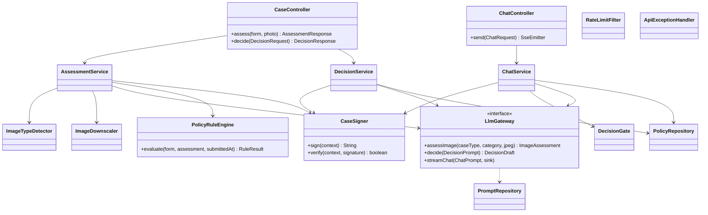
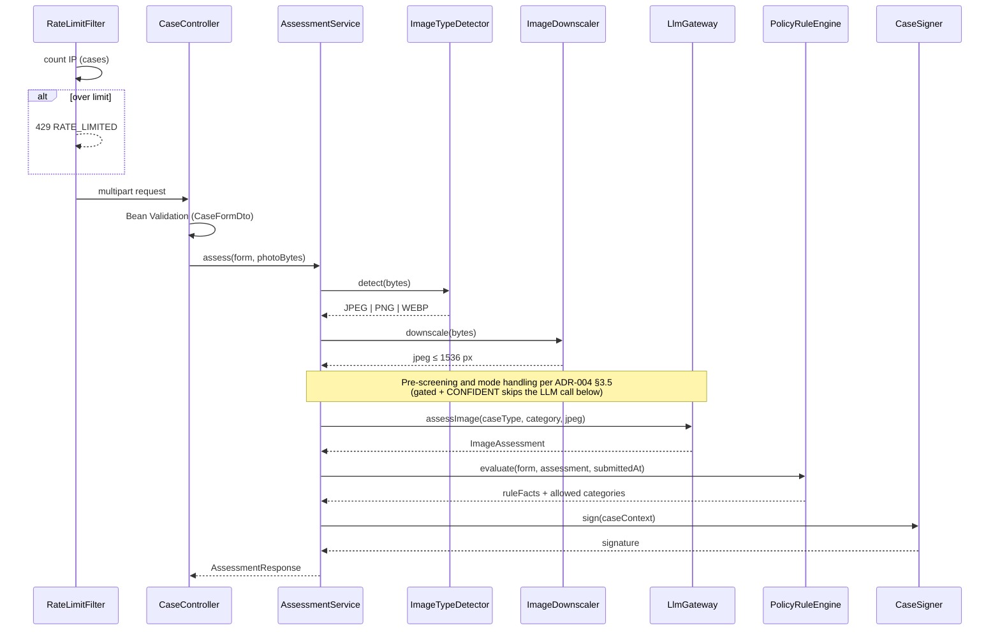
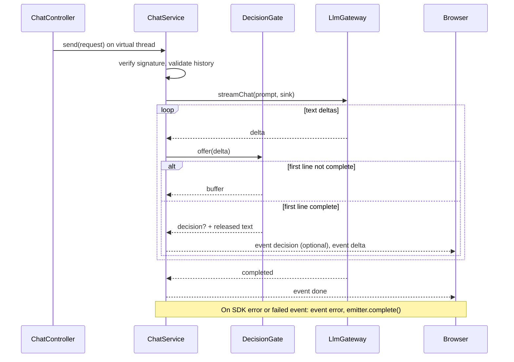

# ADR-001: Backend — Spring Boot Project, API and Packaging

**Date:** 2026-11-25
**Status:** Accepted
**Relates to:** [`000-main-architecture.md`](000-main-architecture.md)

---

## 1. Scope

Covers the Spring Boot backend in `app/backend`: project initialization with Maven, packages and components, HTTP contracts (REST + SSE), validation, image processing, signing, rate limiting, error handling, configuration, frontend packaging into the JAR and the Dockerfile.

Not covered: prompts, model calls and decision guardrails ([`002-llm-integration.md`](002-llm-integration.md)); Angular application ([`003-frontend.md`](003-frontend.md)).

---

## 2. Technology Documentation References

| Library | Context7 ID or official docs | Used for |
|---|---|---|
| Spring Boot 4.2.0 | `/spring-projects/spring-boot` (up to v4.1.0), `/websites/spring_io_spring-boot` · https://docs.spring.io/spring-boot/ | Framework, configuration properties, Actuator |
| Spring Boot system requirements | https://docs.spring.io/spring-boot/system-requirements.html | Java 17–27, Maven 3.6.3+, Tomcat 11 / Servlet 6.1 |
| Spring Initializr | https://start.spring.io · https://start.spring.io/metadata/client | Project generation (dependency ids) |
| Spring MVC `SseEmitter` | https://docs.spring.io/spring-framework/reference/web/webmvc/mvc-ann-async.html | SSE streaming |
| frontend-maven-plugin 2.0.2 | https://github.com/eirslett/frontend-maven-plugin | Node/npm install and Angular build in Maven |
| Thumbnailator 0.4.21 | https://github.com/coobird/thumbnailator | Downscaling, EXIF orientation |
| TwelveMonkeys imageio-webp 3.15.3 | https://github.com/haraldk/TwelveMonkeys | WebP decoding (read-only) |
| WireMock | https://wiremock.org/docs/ | OpenRouter HTTP stubs in integration tests (pin the current 3.x release at implementation time) |

---

## 3. Component Design

### 3.1 Project initialization (Maven + Spring Initializr)

Generate the project once with Spring Initializr and commit the result, including the Maven wrapper:

| Initializr parameter | Value |
|---|---|
| `type` | `maven-project` |
| `language` | `java` |
| `bootVersion` | `4.2.0` |
| `javaVersion` | `25` |
| `groupId` / `artifactId` / `name` | `pl.elektrodemo` / `service-copilot` / `service-copilot` |
| `packageName` | `pl.elektrodemo.copilot` |
| `packaging` | `jar` |
| `dependencies` | `web`, `validation`, `actuator` |
| `baseDir` | `backend` (unzip into `app/`) |

The equivalent request is `https://start.spring.io/starter.zip` with these parameters (via `curl -d` form fields) or the same choices in the web UI. After generation, add to `pom.xml` manually:

- `com.openai:openai-java:4.113.0`
- `net.coobird:thumbnailator:0.4.21`
- `com.twelvemonkeys.imageio:imageio-webp:3.15.3`
- test scope: `org.wiremock:wiremock-standalone` (current 3.x; verify Jetty compatibility with Boot 4.2 — use the standalone artifact to avoid classpath clashes)
- `com.github.eirslett:frontend-maven-plugin:2.0.2` (build plugin, §3.6)
- `maven-resources-plugin` execution copying `../../docs/policies/*.md` to `target/classes/policies/` (single source of truth for policies)

Verify the generated project before adding code: `./mvnw -v` reports Java 25; `./mvnw test` passes the generated context test. Record the exact Maven wrapper version used.

**Jackson note (verify at implementation):** Spring Boot 4 uses Jackson 3 (`tools.jackson`) for its own JSON handling, while `openai-java` depends on Jackson 2 (`com.fasterxml.jackson`, ≥ 2.13.4 enforced by the SDK at runtime). The two coexist because they use different packages. Check `./mvnw dependency:tree` and ensure the SDK's Jackson 2 version is not downgraded by dependency management. Application DTOs use the Spring-managed mapper; SDK structured-output classes use the annotations the SDK documents.

### 3.2 Packages

| Package | Components | Responsibility |
|---|---|---|
| `…copilot.web` | `CaseController`, `ChatController`, `SpaFallbackController`, `ApiExceptionHandler` (`@RestControllerAdvice`), `RateLimitFilter` | HTTP mapping, Bean Validation, ProblemDetail errors, SSE emitter lifecycle |
| `…copilot.cases` | `AssessmentService`, `DecisionService`, `PolicyRuleEngine`, `DecisionMessageValidator` | Use cases for step 1 and step 2; deterministic rules |
| `…copilot.chat` | `ChatService`, `DecisionGate`, `ChatHistoryValidator` | History validation, streaming relay, decision update detection |
| `…copilot.prescreen` | `DecisionsClient`, `PrescreenService`, `PrescreenQuestionCatalog`, `ConfidenceGate`, `PrescreenAssessmentMapper`, `ShadowComparator` | Jev Decisions pre-screening (ADR-004) |
| `…copilot.llm` | `OpenRouterClientConfig`, `LlmGateway` (interface), `OpenAiSdkLlmGateway`, `LlmProperties` | All SDK usage (ADR-002) |
| `…copilot.prompts` | `PromptRepository` | Loads `classpath:prompts/*.md` once at startup; fails fast if missing |
| `…copilot.policy` | `PolicyRepository` | Loads `classpath:policies/return-policy.md` and `complaint-policy.md`; fails fast if missing |
| `…copilot.image` | `ImageTypeDetector`, `ImageDownscaler` | Magic-byte detection, decode, downscale, JPEG re-encode |
| `…copilot.security` | `CaseSigner`, `CanonicalJson`, `RateLimiter` | HMAC-SHA256 sign/verify, canonical serialization, fixed-window counters |
| `…copilot.config` | `AppProperties` (`@ConfigurationProperties("app")`), `ClockConfig` | Typed config, injectable `Clock` (Europe/Warsaw) for testable dates |

Controllers contain no business logic; services receive a `Clock` and never call `LocalDate.now()` directly.

### 3.3 Validation

- Bean Validation annotations on request DTOs (`@NotNull`, `@Size`, `@PastOrPresent` evaluated with the injected clock via a custom validator for Europe/Warsaw).
- Conditional rule (complaint reason ≥ 10 characters after trim) in a class-level validator `@ValidCaseForm`.
- Strings are trimmed before length checks; the trimmed value is used further.
- Errors are collected (not fail-fast) and returned as `fieldErrors` with the **same Polish messages as the PRD** so the frontend can show server-side errors if client validation is bypassed.

### 3.4 Image processing

1. `ImageTypeDetector` reads the first 12 bytes: JPEG `FF D8 FF`, PNG `89 50 4E 47 0D 0A 1A 0A`, WebP `RIFF????WEBP`. Anything else → `UNSUPPORTED_IMAGE`. The multipart `Content-Type` and file name are ignored (AC-09).
2. Size limit: `spring.servlet.multipart.max-file-size=10MB`, `max-request-size=11MB`; exceeding → `413 PHOTO_TOO_LARGE`.
3. Decode with ImageIO (TwelveMonkeys registers the WebP reader through the service loader). Decode failure → `UNSUPPORTED_IMAGE`.
4. `ImageDownscaler` uses Thumbnailator: apply EXIF orientation, fit inside 1536 × 1536 px without upscaling, flatten alpha onto white, encode JPEG quality 0.85. Re-encoding strips all metadata (EXIF GPS). Target size 1536 px is the ADR value referenced by AC-15.
5. Reject decoded images larger than 40 megapixels before resizing (decompression-bomb guard) with `UNSUPPORTED_IMAGE`.
6. The processed JPEG is passed to the LLM layer as bytes; it is never written to disk or logged.

### 3.5 Streaming (SSE) relay

- `ChatController` returns an `SseEmitter` with timeout 90 s; `spring.mvc.async.request-timeout=90s`.
- The streaming work runs on a virtual-thread executor (`spring.threads.virtual.enabled=true`).
- Response headers: `Content-Type: text/event-stream`, `Cache-Control: no-cache`, `X-Accel-Buffering: no`. Response compression is disabled for `text/event-stream` (`server.compression.enabled=false` for the PoC).
- When the client disconnects (`onCompletion`/`onError`/`IOException` on send), the relay closes the SDK `StreamResponse` to stop reading from OpenRouter.
- Events (UTF-8 JSON `data`): see §5.3.

### 3.6 Frontend build inside Maven

`frontend-maven-plugin` in `app/backend/pom.xml` with `workingDirectory=../frontend`:

| Execution | Phase | Goal / arguments |
|---|---|---|
| install node and npm | `generate-resources` | `install-node-and-npm`, Node `v24` LTS (pin the exact patch, must satisfy Angular 22 `^24.15.0`) |
| npm ci | `generate-resources` | `npm ci` |
| frontend unit tests | `test` | `npm run test -- --watch=false` (Vitest) |
| frontend build | `generate-resources` | `npm run build` (production configuration) |

`maven-resources-plugin` then copies `../frontend/dist/frontend/browser/**` to `${project.build.outputDirectory}/static`. All frontend executions are skipped when `-Dskip.frontend=true`. `SpaFallbackController` forwards `GET` requests that are not `/api/**`, not `/actuator/**` and have no file extension to `/index.html`.

### 3.7 Configuration (`application.yaml`)

Key properties: `server.port=${SERVER_PORT:8080}`, multipart limits (§3.4), `spring.threads.virtual.enabled=true`, `spring.mvc.async.request-timeout=90s`, `management.endpoints.web.exposure.include=health`, `server.error.include-stacktrace=never`, `server.error.include-message=never`, `spring.mvc.problemdetails.enabled=true`, and the `app.*` / `llm.*` properties bound from the env variables in ADR-000 §7.

### 3.8 Dockerfile (`app/Dockerfile`, build context = repository root)

- Stage `build`: `eclipse-temurin:25-jdk` (pin a digest or full tag at implementation); copies `app/` and `docs/policies/`; runs `./mvnw -f app/backend/pom.xml -B package -DskipTests` (tests run in CI/locally, not in the image build).
- Stage `runtime`: `eclipse-temurin:25-jre`; non-root user; copies the JAR; `EXPOSE 8080`; `HEALTHCHECK` on `/actuator/health`; `ENTRYPOINT java -jar app.jar`.
- The API key is supplied at run time (`docker run -e OPENROUTER_API_KEY=…` or `--env-file .env`), never baked into the image. Add a `.dockerignore` excluding `node_modules`, `target`, `dist`, `.env`.

---

## 4. Data Structures

| DTO | Fields | Notes |
|---|---|---|
| `CaseFormDto` | `caseType`, `category`, `modelName`, `purchaseDate`, `reason` | Enums as upper-case strings (ADR-000 §5) |
| `AssessmentResponse` | `caseContext` (`CaseContextDto`), `signature` | `caseContext.decision` is absent |
| `CaseContextDto` | `contextVersion`, `caseType`, `form`, `submittedAt`, `assessment`, `ruleFacts`, `decision` (optional: `category`) | Canonical JSON = sorted keys, no insignificant whitespace, ISO dates |
| `DecisionRequest` | `caseContext`, `signature` | — |
| `DecisionResponse` | `decision` {`category`, `message`}, `caseContext`, `signature` | `caseContext.decision.category` set |
| `ChatRequest` | `caseContext`, `signature`, `messages[]` {`id`, `role`, `text`} | Last message must have `role=user`; 1–100 messages; user text 1–2000 chars; assistant text ≤ 20,000 chars; first message must be the assistant decision message |
| `ProblemDetail` | `type`, `title`, `status`, `detail` (Polish), `code`, `fieldErrors[]` {`field`, `message`} | `instance` = request path; never stack trace |

---

## 5. Interface Contracts

### 5.1 `POST /api/cases/assessments`

- **Input:** `multipart/form-data`, parts `form` (`application/json`, `CaseFormDto`) and `photo` (binary).
- **Output 200:** `AssessmentResponse`.
- **Errors:** `400 VALIDATION_FAILED` (+ `fieldErrors`), `400 UNSUPPORTED_IMAGE` ("Nieobsługiwany format. Dodaj zdjęcie JPEG, PNG lub WebP."), `413 PHOTO_TOO_LARGE` ("Zdjęcie przekracza limit 10 MB."), `429 RATE_LIMITED` ("Wysłano zbyt wiele zgłoszeń. Spróbuj ponownie później."), `502 LLM_FAILED` / `504 LLM_TIMEOUT` ("Nie udało się przygotować decyzji. Spróbuj ponownie za chwilę.").
- **Notes:** step budget 26 s (ADR-002 §3.5), including Jev Decisions pre-screening (ADR-004 §3.7; timeout 6 s, never surfaces an error itself); counts against `RATE_LIMIT_CASES_PER_HOUR`.

### 5.2 `POST /api/cases/decisions`

- **Input:** `DecisionRequest` (JSON).
- **Output 200:** `DecisionResponse`.
- **Errors:** `400 VALIDATION_FAILED`, `401 INVALID_CASE_SIGNATURE` ("Nie udało się odczytać zgłoszenia. Rozpocznij nowe zgłoszenie."), `409 DECISION_ALREADY_MADE` if `caseContext.decision` is already present, `502 LLM_FAILED`, `504 LLM_TIMEOUT`.
- **Notes:** step budget 34 s; idempotent from the client's perspective (a retry produces a new decision for the same context).

### 5.3 `POST /api/chat/messages`

- **Input:** `ChatRequest` (JSON). `Accept: text/event-stream`.
- **Pre-stream errors** (normal `problem+json` response, no stream): `400`, `401`, `429` ("Wysłano zbyt wiele wiadomości. Spróbuj ponownie później.").
- **Stream events** (`event:` name, `data:` JSON):

| Event | Data | When |
|---|---|---|
| `decision` | `{"category": "ESCALATED"}` | At most once, before the first `delta`, when the reply starts with a valid "Zaktualizowana decyzja: <label>" line |
| `delta` | `{"text": "…"}` | Each chunk of reply text, in order |
| `done` | `{"category": <current or updated category>}` | Reply finished successfully |
| `error` | `{"code": "LLM_FAILED" \| "LLM_TIMEOUT"}` | Any failure after the stream started (HTTP status already 200) |

- **Notes:** a stream always ends with exactly one of `done` or `error`. Server sends an SSE comment heartbeat every 15 s while waiting for the first token.

### 5.4 Other

- `GET /actuator/health` → `{"status":"UP"}`.
- `GET /**` (SPA routes) → `index.html`; static assets served with cache headers from Spring defaults.

---

## 6. Technical Decisions

### 6.1 Two-step submission endpoints instead of one
**Status:** Accepted
**Date:** 2026-11-25
**Context:** The progress screen shows two stages ("Analizujemy zdjęcie", "Przygotowujemy decyzję") and retry should repeat only the failed step.
**Decision:** Separate `POST /api/cases/assessments` and `POST /api/cases/decisions`; the frontend orchestrates them and drives the stage indicators from real responses.
**Rejected alternatives:**
- One multipart endpoint streaming stage events over SSE: one long request is harder to retry partially and mixes multipart upload with streaming.
- One blocking endpoint with a fake progress animation: stage status would not be real.
**Consequences:**
- (+) Real progress, partial retry, smaller and independently testable endpoints.
- (-) The assessment travels back to the browser between steps (protected by HMAC, ADR-000 Decision 8.4).
**Review trigger:** If the steps are merged into a single model call.

### 6.2 Image downscaling on the server, thumbnail in the browser
**Status:** Accepted
**Date:** 2026-11-25
**Context:** AC-15 requires downscaling before analysis; AC-38 requires a thumbnail that survives reload.
**Decision:** The original photo (≤ 10 MB) is uploaded and downscaled on the server to 1536 px JPEG; the browser separately creates a 320 px thumbnail for storage.
**Rejected alternatives:**
- Downscale only in the browser: the server could not guarantee AC-15 or strip metadata for clients that bypass the UI.
- Store the full photo in the browser: exceeds the `localStorage` quota.
**Consequences:**
- (+) Server enforces size, format and metadata stripping; storage stays small.
- (-) Upload of up to 10 MB per submission (acceptable for a PoC).
**Review trigger:** If mobile upload time becomes a problem in tests.

### 6.3 RFC 9457 ProblemDetail with stable error codes
**Status:** Accepted
**Date:** 2026-11-25
**Context:** AC-43 forbids technical details in customer-visible errors, while the frontend needs to choose the right message.
**Decision:** All errors go through `ApiExceptionHandler`, which maps exceptions to the code table in ADR-000 §6 with fixed Polish `detail` texts. Unknown exceptions → `500 INTERNAL` with a generic Polish message; the exception is logged server-side with a request ID only.
**Rejected alternatives:** Spring's default error page/JSON: can leak exception messages.
**Consequences:**
- (+) One predictable error shape; easy test helper for AC-43.
- (-) Every new failure needs an explicit mapping.
**Review trigger:** When the API gets external consumers needing localization.

---

## 7. Diagrams

### Component diagram

### Sequence: assessment request inside the backend

### Sequence: chat SSE relay

---

## 8. Testing Strategy

### Test scenarios for this area

| Scenario | Type | Input | Expected output | Edge cases |
|---|---|---|---|---|
| Form validation messages | Unit (validator) | Each invalid field | PRD Polish messages, all errors returned | Trim, boundary lengths, Europe/Warsaw "today" via fixed `Clock` |
| Magic bytes | Unit | JPEG/PNG/WebP/GIF/HEIC/empty/3-byte file | Correct type or `UNSUPPORTED_IMAGE` | JPEG named `.png` (AC-09) |
| Downscale | Unit | Example images + generated 4000×3000 + EXIF orientation 6 | ≤ 1536 px, rotated upright, no EXIF, JPEG | Small image not upscaled; PNG with alpha flattened; >40 MP rejected |
| Multipart limit | Integration (MockMvc) | 10 MB + 1 byte | `413 PHOTO_TOO_LARGE` problem+json | Exactly 10 MB accepted |
| HMAC | Unit | Context, tampered field, reordered keys, wrong key | Verify true/false as expected | Constant-time comparison |
| Signature on endpoints | Integration | Tampered `assessment.confidence` | `401 INVALID_CASE_SIGNATURE` | Missing signature → `400` |
| Rate limit | Unit + Integration | 11 requests same IP within window; new window | 11th → `429`; reset after window with fixed `Clock` | Different IPs independent |
| Problem details | Integration | Each error code | Body shape, Polish detail, no technical data (TAC-05) | Unknown exception → `500 INTERNAL` |
| SSE contract | Integration (MockMvc async + WireMock capture) | Captured stream | `delta…`, `done`; one terminal event | Client disconnect closes upstream; heartbeat comment while idle |
| SPA fallback | Integration | `GET /chat`, `GET /main.js`, `GET /api/unknown` | `index.html`, static file, `404` problem | `/actuator/health` untouched |
| Policies on classpath | Unit | Load both policies | Content equals `docs/policies/*.md` byte-for-byte | Missing file fails startup |
| Packaging | Build check | `./mvnw verify` | JAR contains `static/index.html` and `policies/*.md` | `-Dskip.frontend=true` still builds the backend |

### Technical acceptance criteria

- TAC-001-01: `POST /api/cases/assessments` with a JPEG renamed to `.png` returns `200`; with a GIF renamed to `.jpg` returns `400` with `code=UNSUPPORTED_IMAGE`.
- TAC-001-02: The image sent to the LLM gateway in integration tests has a longer side ≤ 1536 px and contains no EXIF segment (`APP1`).
- TAC-001-03: Any change to a signed `caseContext` field results in `401 INVALID_CASE_SIGNATURE` on `/decisions` and `/chat/messages`.
- TAC-001-04: Every chat stream in the integration suite ends with exactly one `done` or `error` event, and the `decision` event, when present, precedes the first `delta`.
- TAC-001-05: The 11th assessment request from one IP within one hour returns `429 RATE_LIMITED` (with default limits).
- TAC-001-06: The packaged JAR serves `index.html` for `/` and for an unknown non-API path, and returns problem+json `404` for an unknown `/api/**` path.
- TAC-001-07: `docker run` of the built image with `OPENROUTER_API_KEY` set reports healthy within 30 s.
