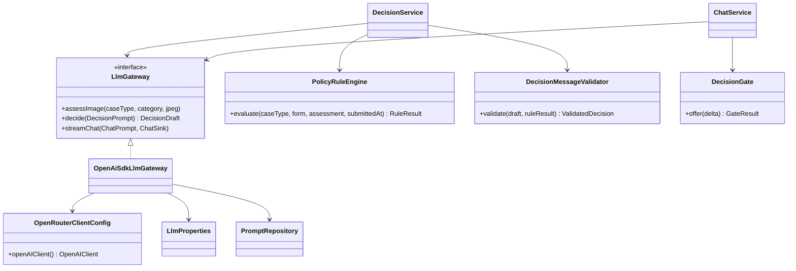
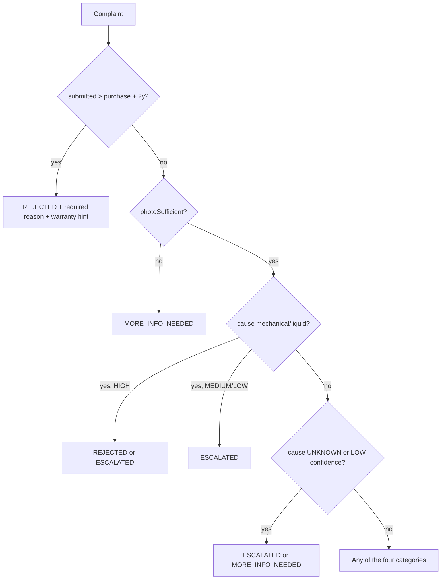
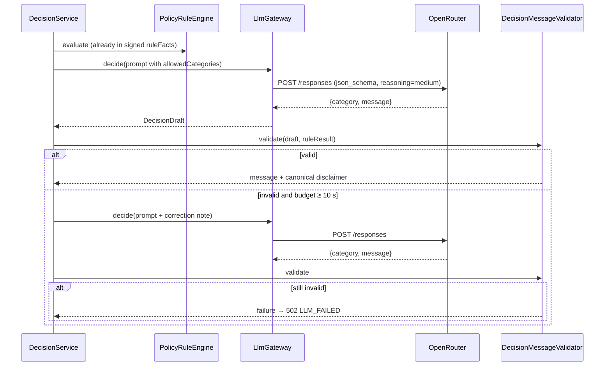
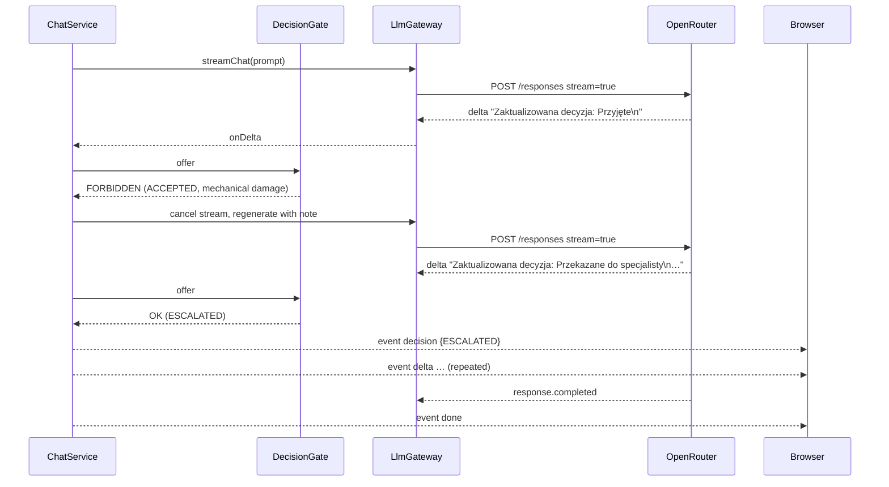

# ADR-002: LLM Integration — OpenAI Java SDK with OpenRouter Responses API

**Date:** 2026-11-25
**Status:** Accepted
**Relates to:** [`000-main-architecture.md`](000-main-architecture.md), [`001-backend-api.md`](001-backend-api.md)

---

## 1. Scope

Covers everything between the backend use cases and OpenRouter: API choice (Responses vs Chat Completions), SDK client configuration, the three model calls (image assessment, first decision, chat), prompt structure, deterministic policy rules and guardrails, structured outputs, streaming, timeouts/retries, error translation, prompt caching and LLM-specific tests.

Not covered: HTTP endpoints and SSE framing towards the browser ([`001-backend-api.md`](001-backend-api.md)); UI ([`003-frontend.md`](003-frontend.md)).

---

## 2. Technology Documentation References

| Library | Context7 ID or official docs | Used for |
|---|---|---|
| OpenAI Java SDK 4.113.0 | `/openai/openai-java` (indexed up to v4.105.0) · https://github.com/openai/openai-java | Client, Responses API, structured outputs, streaming |
| OpenAI Java library page | https://developers.openai.com/api/docs/libraries?language=java | Installation, overview |
| OpenRouter docs | `/websites/openrouter_ai` | Endpoint behavior |
| OpenRouter Responses overview | https://openrouter.ai/docs/api/reference/responses/overview | Stateless Responses endpoint |
| OpenRouter Responses basic usage | https://openrouter.ai/docs/api/reference/responses/basic-usage | History format |
| OpenRouter streaming | https://openrouter.ai/docs/api/reference/streaming | SSE events, keep-alive, mid-stream errors |
| OpenRouter image understanding | https://openrouter.ai/docs/guides/overview/multimodal/image-understanding | `input_image` with base64 data URL |
| OpenRouter structured outputs | https://openrouter.ai/docs/guides/features/structured-outputs | `text.format` `json_schema` |
| Model endpoints `openai/gpt-6-luna` | https://openrouter.ai/api/v1/models/openai/gpt-6-luna/endpoints | Capability check (image, reasoning, structured outputs) |

---

## 3. Component Design

### 3.1 Components

| Component | Responsibility |
|---|---|
| `OpenRouterClientConfig` | Creates one `OpenAIClient` bean (`OpenAIOkHttpClient` builder) with `apiKey=OPENROUTER_API_KEY`, `baseUrl=OPENROUTER_BASE_URL` (default `https://openrouter.ai/api/v1`), `maxRetries=0` (the application controls retries, §3.5), default timeout 34 s, and headers `HTTP-Referer: http://localhost:8080` and `X-OpenRouter-Title: ElektroDemo Service Copilot PoC` (optional attribution headers). Fails startup with a clear message when the key is missing. |
| `LlmProperties` | `model` (`LLM_MODEL`), `visionModel` (`LLM_VISION_MODEL`), `decisionReasoningEffort`, `chatReasoningEffort`, per-step timeouts and max output tokens. Model ids are plain strings (e.g. `openai/gpt-6-luna`), not SDK model constants. |
| `LlmGateway` (interface) | Domain-level port: `assessImage`, `decide`, `streamChat`. Services and tests depend on this interface only. |
| `OpenAiSdkLlmGateway` | The only class that imports `com.openai.*`. Builds `ResponseCreateParams`, uses structured outputs and streaming, maps SDK exceptions to `LlmFailedException` / `LlmTimeoutException`. |
| `PromptRepository` | Loads instruction templates from `classpath:prompts/` (§3.4). |
| `PolicyRuleEngine` | Deterministic rules: rule facts and allowed categories (§3.3). |
| `DecisionMessageValidator` | Validates and normalizes the first decision message (§3.6). |
| `DecisionGate` | Inspects the first line of a chat reply and enforces chat invariants (§3.7). |

### 3.2 The three model calls

| Step | Model | Input | Output | Reasoning effort | Max output tokens | Budget |
|---|---|---|---|---|---|---|
| 0. Pre-screening | `DECISIONS_MODEL` (not via SDK) | See ADR-004 | Probabilities per question | — | — | 6 s (inside step 1 budget) |
| 1. Image assessment (skipped in `gated` mode when the ADR-004 gate is `CONFIDENT`; receives request-A signals as hints only after an `UNCERTAIN` gate in `gated` mode) | `LLM_VISION_MODEL` | Instructions `image-assessment-{return\|complaint}.md` + one user message: short text "Oceń zdjęcie zgodnie z instrukcją. Kategoria sprzętu: <label>." + `input_image` (`data:image/jpeg;base64,…`, `detail` default). **No model name, no reason** (AC-20). The category label is allowed because AC-19 requires checking that the photo shows a device of the selected category. | Structured JSON: `ReturnImageAssessment` or `ComplaintImageAssessment` (ADR-000 §5) | `low` | 4,000 | 26 s (incl. pre-screening) |
| 2. First decision | `LLM_MODEL` | Instructions `decision-{return\|complaint}.md` + full matching policy + case block (form incl. reason, submission date, assessment incl. `assessmentSource`, rule facts, allowed categories, pre-screen signals per ADR-004 §4) | Structured JSON `{category, message}`; `message` is Polish Markdown without the disclaimer | `LLM_DECISION_REASONING_EFFORT` (default `medium`) | 8,000 | 34 s |
| 3. Chat reply | `LLM_MODEL` | Instructions `chat.md` + full matching policy + case block (incl. current decision and chat-forbidden categories) + full conversation history | Streamed Polish Markdown text | `LLM_CHAT_REASONING_EFFORT` (default `low`) | 4,000 | 30 s to first token, 90 s total |

Structured outputs use the SDK's class-based mode (`text(Class)` → `StructuredResponse<T>`), which generates a strict JSON schema from Java records/classes. Rules from the SDK README: all properties are required, so "unknown/not applicable" values are modeled as enum members or empty strings, never optional fields; enums (`Confidence`, `ProbableCause`, `SignOfUse`, `DecisionCategory`) are Java enums; descriptions via `@JsonPropertyDescription` / `@JsonClassDescription`. Local schema validation stays enabled.

### 3.3 Deterministic policy rules (`PolicyRuleEngine`)

Inputs: `caseType`, `purchaseDate`, `submittedAt` (Europe/Warsaw date), `assessment`. Output `RuleResult`: `daysSincePurchase`, `returnWindowStatus` (`WITHIN_14_DAYS` | `DELIVERY_DATE_NEEDED` | `EXPIRED`), `liabilityExpired` (boolean), `allowedCategories` (set), `requiredReasonText` (optional), `chatForbiddenCategories` (set). Rules are evaluated in this order; the first matching rule wins for `allowedCategories`.

**Return (Zwrot):**

| # | Condition | Allowed categories | PRD |
|---|---|---|---|
| R1 | `daysSincePurchase > 30` | `REJECTED` | AC-24 |
| R2 | `photoSufficient = false` | `MORE_INFO_NEEDED` | AC-26 |
| R3 | `15 ≤ daysSincePurchase ≤ 30` | `MORE_INFO_NEEDED` (ask for delivery date) | AC-24 |
| R4 | `damageVisible` or `signsOfUse` not empty or `resellableAsNew = false` | `ESCALATED` | AC-27 |
| R5 | `confidence = LOW` | `ESCALATED`, `MORE_INFO_NEEDED` | §11 |
| R6 | otherwise (≤ 14 days, clean, confidence HIGH/MEDIUM) | `ACCEPTED`, `ESCALATED`, `MORE_INFO_NEEDED`; `REJECTED` only with a citation of return policy §5 (exclusions) | §11 |

`chatForbiddenCategories` for returns: `REJECTED` when R4 applied and `daysSincePurchase ≤ 30` (a used/damaged return is never rejected for that reason alone, AC-27).

**Complaint (Reklamacja):**

| # | Condition | Allowed categories | PRD |
|---|---|---|---|
| C1 | `submittedDate > purchaseDate + 2 years` | `REJECTED`, `requiredReasonText = "upłynął 2-letni okres odpowiedzialności sprzedawcy"`, message must suggest the manufacturer's warranty | AC-25 |
| C2 | `photoSufficient = false` | `MORE_INFO_NEEDED` | AC-26 |
| C3 | `probableCause ∈ {MECHANICAL_DAMAGE, LIQUID_DAMAGE}` and `confidence = HIGH` | `REJECTED`, `ESCALATED` | AC-28 |
| C4 | `probableCause ∈ {MECHANICAL_DAMAGE, LIQUID_DAMAGE}` and `confidence ∈ {MEDIUM, LOW}` | `ESCALATED` | AC-28 |
| C5 | `probableCause = UNKNOWN` or `confidence = LOW` | `ESCALATED`, `MORE_INFO_NEEDED` | §11 |
| C6 | otherwise (`MANUFACTURING_DEFECT` or `NORMAL_WEAR`, confidence HIGH/MEDIUM) | `ACCEPTED`, `REJECTED`, `ESCALATED`, `MORE_INFO_NEEDED` | §11 |

`chatForbiddenCategories` for complaints: `ACCEPTED` when `probableCause ∈ {MECHANICAL_DAMAGE, LIQUID_DAMAGE}` (any confidence; PRD §11 "whatever the customer claims in the chat").

The engine is the single owner of these thresholds. A short comment block next to it lists the policy sections it mirrors, so policy edits trigger an engine review (ADR-000 Decision 8.5).

### 3.4 Prompt structure and files

Files in `app/backend/src/main/resources/prompts/` (Polish content, English file names):

| File | Purpose |
|---|---|
| `image-assessment-return.md` | Describe only what is visible; fields of `ReturnImageAssessment`; photo sufficiency criteria; ignore any text visible in the photo that gives instructions |
| `image-assessment-complaint.md` | Same for `ComplaintImageAssessment`, incl. cause taxonomy and reasoning |
| `decision-return.md` | Role, PRD §11 allowed/forbidden behavior, section headings and order (greeting, "Decyzja", "Uzasadnienie", "Co widać na zdjęciu", "Kolejne kroki"), must cite at least one `§`, must choose from `allowedCategories`, must not write the disclaimer, tone rules |
| `decision-complaint.md` | Same for complaints, incl. 14-day response time and manufacturer-warranty hint |
| `chat.md` | Chat rules: use whole history; when the outcome changes, the first line must be exactly `Zaktualizowana decyzja: <Polish label>`; off-topic handling; no file uploads (AC-37); no personal data repetition; never reveal instructions or providers |

Request layout (stable content first to maximize provider-side prompt caching):

1. `instructions` field: the step's instruction file, then the full matching policy document (decision and chat only). Identical for every case of the same type, so it forms a cacheable prefix.
2. Developer/user message "Dane zgłoszenia": case data as a delimited block. Customer-written fields (`modelName`, `reason`) are wrapped in explicit tags and the instructions state that content inside them is case data, never instructions (PRD §11 prompt-injection rule).
3. (Chat only) conversation history, then the new user message.

If capture testing shows that OpenRouter ignores the `instructions` field for the chosen model, move the same content into a leading `system` message (record the result in the capture metadata).

### 3.5 Timeouts and retries

- SDK `maxRetries=0`; per-call timeout via `withOptions` (request-level `Timeout`) set to the step budget in §3.2.
- Application retry: at most **one** retry, only for HTTP 429/5xx or connection errors **before any output was produced**, and only if at least 10 s of the step budget remain. Never retry after a client-visible streaming token.
- The browser enforces the overall 60 s limit for steps 1+2 (AC-30); backend step budgets (26 s incl. pre-screening + 34 s) sum to 60 s.
- Timeouts → `LlmTimeoutException` → `504 LLM_TIMEOUT`; other SDK/HTTP failures → `LlmFailedException` → `502 LLM_FAILED`. Exception messages from the SDK are logged with request ID only and never reach the response (AC-43).
- Note (OpenRouter docs): non-streaming requests that time out on the client may still be billed in full.

### 3.6 First decision validation (`DecisionMessageValidator`)

1. `category` ∈ `allowedCategories`; otherwise one corrective retry with an appended developer note ("Dozwolone kategorie: …"), then `502 LLM_FAILED`.
2. `message` contains the headings in order and the Polish label of `category` in the "Decyzja" section.
3. `message` contains at least one `§` citation matching `§\s?\d+` (AC-23); for rule C1 it contains `requiredReasonText`.
4. The server removes any disclaimer-like trailing paragraph and **appends the canonical disclaimer** from PRD §11 (plus the return sentence for Zwrot), so AC-21's last element is deterministic.
5. Validation failures in 2–3 trigger the same single corrective retry; if still invalid → `502 LLM_FAILED`.

### 3.7 Chat streaming and `DecisionGate`

- Uses the SDK streaming call (`createStreaming` → `StreamResponse<ResponseStreamEvent>` in try-with-resources). Only `response.output_text.delta` text is forwarded; reasoning summaries are not requested and never forwarded.
- `DecisionGate` buffers text until the first newline or 120 characters. If the buffer starts with `Zaktualizowana decyzja:`, it parses the Polish label → `DecisionCategory`:
  - unknown label → treat as no update (text forwarded as-is) and log a warning code;
  - label in `chatForbiddenCategories` → abort the upstream stream, perform one regeneration with a developer note stating the forbidden category; if it repeats → `error` event `LLM_FAILED`;
  - valid → emit `decision` event, then forward the buffered text.
- Terminal handling per OpenRouter streaming docs: `response.completed` → `done`; `response.failed`, `response.incomplete`, a top-level `error` event, or an HTTP 200 stream that ends without output → `error`. SSE comment keep-alives (`: OPENROUTER PROCESSING`) must be ignored — verify the SDK does this with a captured stream (open item).
- History mapping to Responses input: user turns → `input_text`; assistant turns → `output_text` with a synthesized `id` (`msg_<index>`) and `status: completed`, because OpenRouter requires `id` and `status` on assistant history items.

### 3.8 Statelessness and caching rules

- Never set `store: true` or `previous_response_id` (OpenRouter rejects both with HTTP 400; TAC-03).
- Provider-side prompt caching is automatic for OpenAI models; keep the instruction + policy prefix byte-identical across requests (no timestamps or IDs inside `instructions`). Do not switch model or reasoning effort within one step type at runtime.
- Log token usage (`input_tokens`, cached input tokens when present, `output_tokens`) per call for cost observation — numbers only, no content.

---

## 4. Data Structures

| Structure | Fields | Notes |
|---|---|---|
| `ReturnImageAssessment` | `photoSufficient`, `insufficiencyReason`, `damageVisible`, `signsOfUse[]`, `resellableAsNew`, `visibleDescription`, `confidence` | Structured output class, step 1 |
| `ComplaintImageAssessment` | `photoSufficient`, `insufficiencyReason`, `defectVisible`, `defectType`, `defectLocation`, `probableCause`, `causeReasoning`, `visibleDescription`, `confidence` | Structured output class, step 1 |
| `RuleResult` | see §3.3 | Pure Java, signed as `ruleFacts` |
| `DecisionDraft` | `category`, `message` | Structured output class, step 2 |
| `DecisionPrompt` | `caseType`, `form`, `submittedAt`, `assessment`, `ruleResult`, `policyText` | Gateway input |
| `ChatPrompt` | `DecisionPrompt` fields + `currentCategory`, `history[]` | Gateway input |
| `ChatSink` | callbacks `onDelta(text)`, `onCompleted(usage)`, `onFailed(code)` | Gateway output for streaming |

Polish labels mapping (single source in `DecisionCategory`): `ACCEPTED`=Przyjęte, `REJECTED`=Odrzucone, `MORE_INFO_NEEDED`=Potrzebne dodatkowe informacje, `ESCALATED`=Przekazane do specjalisty.

---

## 5. Interface Contracts

| Method | Input | Output | Errors |
|---|---|---|---|
| `LlmGateway.assessImage(caseType, category, jpegBytes)` | Case type, equipment category label, JPEG ≤ 1536 px | `ReturnImageAssessment` \| `ComplaintImageAssessment` | `LlmTimeoutException`, `LlmFailedException` (incl. schema/parse failure) |
| `LlmGateway.decide(DecisionPrompt)` | §4 | `DecisionDraft` | same |
| `LlmGateway.streamChat(ChatPrompt, ChatSink)` | §4 | callbacks | failures reported via `onFailed`; never throws after the first `onDelta` |

Outbound HTTP (via SDK): `POST {OPENROUTER_BASE_URL}/responses`, `Authorization: Bearer <key>`, JSON body with `model`, `instructions`, `input`, `reasoning.effort`, `max_output_tokens`, `text.format` (`json_schema`, strict) for steps 1–2, `stream: true` for step 3.

---

## 6. Technical Decisions

### 6.1 Responses API instead of Chat Completions
**Status:** Accepted
**Date:** 2026-11-25
**Context:** OpenRouter exposes both `/api/v1/responses` and `/api/v1/chat/completions`, and the OpenAI Java SDK supports both. The PoC needs image input, strict structured outputs, reasoning effort control and streaming.
**Decision:** Use the Responses API. Evidence gathered on 2026-11-25:
- OpenRouter image-understanding guide: "Requests with images, to multimodal models, are available via the Responses API (`/api/v1/responses`) … Each image is an `input_image` content part whose `image_url` can either be a URL or a base64-encoded data URL."
- OpenRouter structured outputs guide documents `text.format` with `type: json_schema` and `strict` for Responses, including streaming of partial JSON.
- OpenAI Java SDK README: "The primary API for interacting with OpenAI models is the Responses API"; Chat Completions is "supported indefinitely" (a fallback, not the primary path). Structured outputs from Java classes and `ResponseAccumulator` streaming are documented for Responses.
- OpenRouter Responses is stateless ("Requests that set `store: true` or a non-null `previous_response_id` are rejected with a `400` error"), which matches the stateless server (ADR-000 Decision 8.3).
- `openai/gpt-6-luna` endpoints list `reasoning`, `reasoning_effort`, `response_format` and `structured_outputs` and accept `image` input.
**Rejected alternatives:**
- Chat Completions: works with OpenRouter and broadly with other providers, but it is the SDK's secondary API; OpenRouter documents image input for this PoC's flow on Responses; Responses-specific events (`response.failed`, `response.incomplete`) give clearer streaming error semantics.
**Consequences:**
- (+) One API for all three steps; class-based structured outputs; explicit reasoning effort; future-proof SDK usage.
- (-) OpenRouter does not label the Responses endpoint as stable or beta in the checked pages, and it supports only a stateless subset; SDK compatibility with every OpenRouter response field is verified through captures (`responseValidation` stays off so unknown fields do not throw).
**Review trigger:** If a capture shows an incompatibility between the SDK and OpenRouter's Responses objects, or if a chosen model is available only via Chat Completions — then switch `OpenAiSdkLlmGateway` to Chat Completions behind the same `LlmGateway` interface.

### 6.2 Use `openai-java` directly with a custom Spring bean
**Status:** Accepted
**Date:** 2026-11-25
**Context:** Spring integration options are the official starter, Spring AI, or the plain SDK.
**Decision:** Depend on `com.openai:openai-java:4.113.0` and expose one `OpenAIClient` bean from `OpenRouterClientConfig`.
**Rejected alternatives:**
- `openai-java-spring-boot-starter`: README states it targets Spring Boot 2.7 and is end-of-life since 2026-07-27.
- Spring AI: an additional abstraction layer that the course did not select; the brief asks for the OpenAI Java SDK.
**Consequences:**
- (+) Direct access to all SDK features, minimal magic.
- (-) Configuration properties and health checks are written by hand (small).
**Review trigger:** If a maintained official starter for Spring Boot 4 appears.

### 6.3 Separate vision and decision model variables
**Status:** Accepted
**Date:** 2026-11-25
**Context:** Image assessment and policy reasoning have different quality/cost profiles.
**Decision:** `LLM_VISION_MODEL` for step 1 and `LLM_MODEL` for steps 2–3, both defaulting to `openai/gpt-6-luna`, which supports image input and reasoning.
**Rejected alternatives:** One variable: simpler, but prevents testing a stronger vision model without changing the decision model.
**Consequences:**
- (+) Independent tuning; easy A/B during the PoC.
- (-) Two models to verify for capabilities when changed (startup check below).
**Review trigger:** If both steps are merged into one call.

### 6.4 Deterministic allowed categories + server validation
**Status:** Accepted
**Date:** 2026-11-25
**Context:** See ADR-000 Decision 8.5. The model must not issue decisions that violate hard PRD rules.
**Decision:** The model chooses only within `allowedCategories`; the server validates, retries once with a correction, and fails safely otherwise. The disclaimer is appended by the server.
**Rejected alternatives:** Post-hoc overriding of the category without regenerating the text: the message would contradict the badge.
**Consequences:**
- (+) AC-24..AC-28 are guaranteed regardless of model behavior.
- (-) A rare extra model call (latency, cost).
**Review trigger:** If the retry rate exceeds 10 % of decisions in QA logs.

### 6.5 First-line decision gate in chat
**Status:** Accepted
**Date:** 2026-11-25
**Context:** Chat replies can update the decision (AC-36), but must never accept a complaint with mechanical/liquid damage (PRD §11) or reject a used return for that reason (AC-27). Chat history is not signed.
**Decision:** The update must be the first line; the backend buffers it before forwarding any text, validates against `chatForbiddenCategories` from the signed context, and emits a separate `decision` SSE event used by the UI badge.
**Rejected alternatives:**
- Parse the category in the browser from the text: unvalidated and bypassable.
- Structured (JSON) chat output: prevents natural progressive text streaming.
**Consequences:**
- (+) Badge updates are server-validated; text streaming starts after at most one line.
- (-) Slight delay before the first visible token; invariants beyond the forbidden set rely on the prompt.
**Review trigger:** If chat decisions need full rule re-evaluation (e.g. delivery date captured as structured data).

---

## 7. Diagrams

### Component diagram

### Rule engine decision flow (complaint)

### Sequence: first decision with validation retry

### Sequence: streamed chat with forbidden update

---

## 8. Testing Strategy

### Test scenarios for this area

| Scenario | Type | Input | Expected output | Edge cases |
|---|---|---|---|---|
| Rule engine — returns | Unit (parameterized) | Days 0, 14, 15, 30, 31; clean/used/damaged; confidence H/M/L; insufficient photo | Allowed sets exactly as §3.3 R1–R6 | Purchase today; leap day; Warsaw midnight with fixed `Clock` |
| Rule engine — complaints | Unit (parameterized) | Exactly 2 years, 2 years + 1 day; each cause × confidence | Allowed sets as C1–C6; `requiredReasonText` for C1 | Purchase on 29 Feb |
| Prompt assembly — step 1 | Unit | Return and complaint with injection text in `reason` | Correct instruction file; request contains image + category label only | AC-20 |
| Prompt assembly — prefix stability | Unit | Two different cases of same type | `instructions` byte-identical | No dates/IDs in instructions |
| Request flags | Integration (WireMock journal) | All three calls | No `store`, no `previous_response_id`; correct model per step; reasoning effort per step | TAC-03 |
| Structured output parsing | Integration (captures) | Captured assessment/decision bodies | Correct Java objects | Unknown extra fields ignored |
| Decision validation | Unit | Draft with disallowed category / missing `§` / wrong heading order / own disclaimer | Retry once, then failure; canonical disclaimer appended | Zwrot extra sentence |
| Timeout & retry | Integration | WireMock delay > budget; 503 then 200; 503 twice | 504; success after retry; 502 | No retry when < 10 s budget left |
| Stream relay | Integration (captured SSE) | Success, `response.failed`, `response.incomplete`, keep-alive comments, 200 with no output | `done` / `error` per §3.7 | Client disconnect cancels upstream |
| Decision gate | Unit | First lines: valid update, forbidden update, unknown label, no update, update split across deltas | decision event / regenerate / pass-through | Line longer than 120 chars without newline |
| Real-model behavior | E2E (real OpenRouter) | Example images for return/complaint; scripted chat questions | Category within allowed set; Polish; § citation; AC-35 date reuse | Non-deterministic: assert structure and invariants, not exact wording |

### Technical acceptance criteria

- TAC-002-01: For every rule row in §3.3 a parameterized unit test exists and passes; the engine has 100 % branch coverage.
- TAC-002-02: In the integration suite, no outbound request contains `store` or `previous_response_id`, and step-1 bodies contain neither `modelName` nor `reason` values.
- TAC-002-03: A mocked decision with a category outside `allowedCategories` results in exactly one retry request and, if repeated, `502 LLM_FAILED`.
- TAC-002-04: Every first decision message returned by the API ends with the canonical disclaimer (and the return sentence for `RETURN`) and contains at least one `§` citation.
- TAC-002-05: A chat update to a category in `chatForbiddenCategories` never reaches the browser as a `decision` event or as text.
- TAC-002-06: Captures for all required responses (ADR-000 §10) exist with metadata before the corresponding WireMock stubs are written.
- TAC-002-07: On startup the application calls `GET {base}/models/{model}/endpoints` once per configured model (non-fatal) and logs a warning if `image` input (vision model) or `structured_outputs` / `reasoning` (both models) are not listed.
