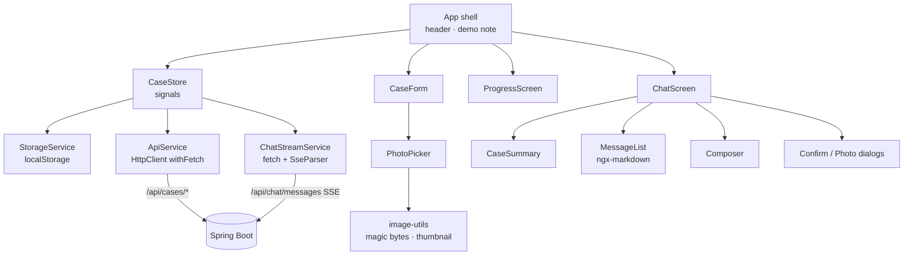
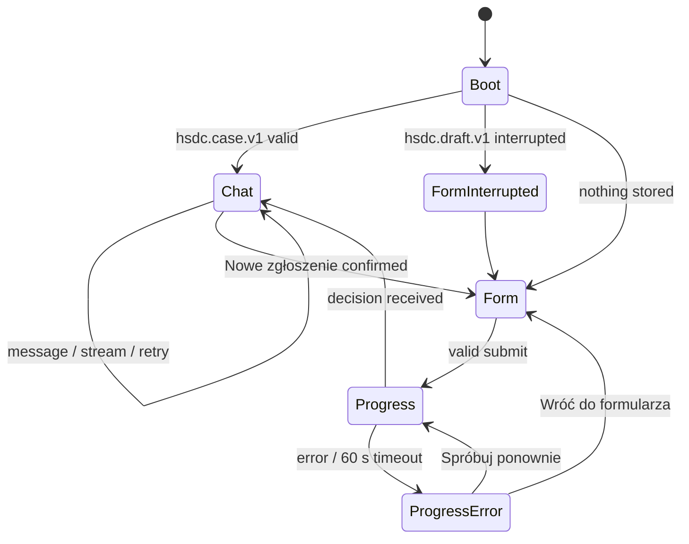
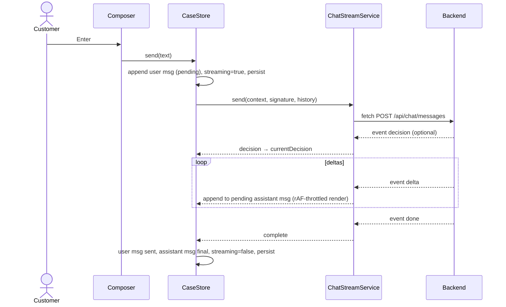

# ADR-003: Frontend — Angular, Angular Material, Chat UI and Streaming Client

**Date:** 2026-11-25
**Status:** Accepted
**Relates to:** [`000-main-architecture.md`](000-main-architecture.md), [`001-backend-api.md`](001-backend-api.md)

---

## 1. Scope

Covers the Angular application in `app/frontend`: project initialization, Angular Material setup and theming from `docs/design-guidelines.md`, screen/component design, form validation, photo handling, chat UI, SSE streaming client, browser persistence, accessibility and frontend tests (Vitest + Playwright).

Not covered: backend contracts ([`001-backend-api.md`](001-backend-api.md)), LLM behavior ([`002-llm-integration.md`](002-llm-integration.md)). The frontend never talks to OpenRouter or the OpenAI SDK directly; it only calls `/api` on its own origin.

---

## 2. Technology Documentation References

| Library | Context7 ID or official docs | Used for |
|---|---|---|
| Angular 22.3 | `/angular/angular` (`__branch__22.0.x`), `/websites/angular_dev` · https://angular.dev | Framework, signals, HttpClient |
| Angular CLI 22 | `/angular/angular-cli` (v22.2.2) · https://angular.dev/cli/new | `ng new`, `ng add`, build, dev proxy |
| Angular zoneless | https://angular.dev/guide/zoneless | Default change detection since v21 |
| Angular HttpClient | https://angular.dev/guide/http/making-requests | JSON and multipart requests (`withFetch()`) |
| Angular Material / CDK 22.3 | `/angular/components` (up to v21.2.14) · https://material.angular.dev | Form controls, dialog, datepicker, theming, layout |
| Material theming | https://material.angular.dev/guide/theming | Material 3 theme + system tokens |
| ngx-markdown 22.1.1 | https://github.com/jfcere/ngx-markdown | Agent message rendering with sanitization |
| Playwright 1.65.1 | https://playwright.dev/docs/intro | E2E and Manual QA |
| Vitest | https://vitest.dev | Unit tests (default runner of `ng new` in v22) |
| Design tokens | `assets/design-tokens.json`, `docs/design-guidelines.md`, `assets/homepage.png` | Brand reference |

---

## 3. Component Design

### 3.1 Project initialization

Run from `app/` with Node 24 LTS (Angular 22 requires `^22.22.3 || ^24.15.0 || >=26`):

| Step | Command / choice | Notes |
|---|---|---|
| 1 | `npx @angular/cli@22.3 new frontend` with `--ssr=false --style=scss --routing=false --skip-git --package-manager=npm --ai-config=none` | Standalone components, zoneless and Vitest are the v22 defaults; no SSR (static files served by Spring Boot); no router (Decision 6.2); AI config skipped because the repo keeps its own nested `AGENTS.md` |
| 2 | `ng add @angular/material@22.3` | Choose a custom theme (configured in §3.7), enable typography, no animations module prompt in v22 if not asked |
| 3 | `npm install ngx-markdown@22.1.1 marked@<peer-compatible ^17 or ^18>` | Use the `marked` version required by ngx-markdown's peer dependencies |
| 4 | `npm install -D @playwright/test@1.65.1` then `npx playwright install chromium` | E2E in `app/frontend/e2e/` |
| 5 | Add `proxy.conf.json` (`/api` → `http://localhost:8080`, `secure: false`) and reference it in `angular.json` → `serve.options.proxyConfig` | Same-origin calls in dev and prod |
| 6 | Set `outputPath` so that the browser bundle is `dist/frontend/browser` (default) | Consumed by Maven (ADR-001 §3.6) |
| 7 | Copy `assets/logo.svg` and `assets/favicon.svg` into `public/`; reference fonts (Google Fonts link from design guidelines) in `index.html` | Verify Polish diacritics render in Bangers; fall back to Atkinson Hyperlegible for headings if any glyph is missing |

Global providers (`app.config.ts`): `provideHttpClient(withFetch())`, `provideMarkdown()` with default HTML sanitization, `provideNativeDateAdapter()`, `MAT_DATE_LOCALE = 'pl-PL'`, `LOCALE_ID = 'pl'` with Polish locale data registered, `provideZonelessChangeDetection()` if not already default.

Development loop: terminal 1 `./mvnw -f app/backend/pom.xml spring-boot:run -Dskip.frontend=true`; terminal 2 `npm start` in `app/frontend` (port 4200, proxy to 8080). Production: the JAR from ADR-001 serves the build.

### 3.2 Application structure

```
src/app/
  app.ts                      Shell: header, demo note, screen switch by state
  core/
    case-store.ts             Signal-based state + persistence (single source of truth)
    storage.service.ts        localStorage read/write with versioned keys, quota/parse guards
    api.service.ts            HttpClient calls: assessments (multipart), decisions (JSON)
    chat-stream.service.ts    fetch + ReadableStream SSE client (Observable)
    sse-parser.ts             Pure incremental SSE parser
    image-utils.ts            Magic-byte detection, thumbnail generation
    models.ts                 Types mirroring ADR-000 §5 and ADR-001 §4
    labels.ts                 Polish labels for enums and all UI texts
  form/
    case-form.ts              Form screen (Reactive Forms, typed)
    photo-picker.ts           Drop zone, preview, remove, hint
  progress/
    progress-screen.ts        Two-stage status + error state
  chat/
    chat-screen.ts            Layout: summary panel + conversation + composer
    case-summary.ts           Summary, thumbnail (opens dialog), decision badge
    message-list.ts           Bubbles, Markdown rendering, failed state, auto-scroll
    composer.ts               Textarea, counter, send button, keyboard handling
    confirm-new-case.dialog.ts
    photo-preview.dialog.ts
```

### 3.3 State management (`CaseStore`)

Signals only (no NgRx). State:

| Signal | Type | Meaning |
|---|---|---|
| `screen` | `'form' \| 'progress' \| 'chat'` | Current screen |
| `formDraft` | CaseForm (without photo) | Form values; persisted as `hsdc.draft.v1` while submitting |
| `photo` | `File \| null` | Selected photo; memory only (needed for retry) |
| `progress` | `{assessment: Status, decision: Status, error: boolean}` | `Status = waiting \| running \| done` |
| `caseContext`, `signature` | from API | Signed context |
| `messages` | ChatMessage[] | Conversation |
| `currentDecision` | DecisionCategory | Badge value |
| `streaming` | boolean | Disables send, shows typing indicator |
| `interruptedNotice` | boolean | Shows the AC-40 message on the form |

Every mutation of `caseContext`, `signature`, `messages`, `currentDecision` writes `hsdc.case.v1` (debounced to animation frame during streaming, immediate on `done`/`error`).

Startup logic (`AC-38`, `AC-40`): valid `hsdc.case.v1` → `chat`; else `hsdc.draft.v1` with `interrupted = true` → `form` with values, no photo, `interruptedNotice = true`; else empty `form`. Unparseable or schema-mismatched storage is cleared.

### 3.4 Screens

**Form (`case-form`)** — Reactive Forms with typed controls in PRD order (AC-01):

| Field | Material control | Validation |
|---|---|---|
| Case type | Two large selectable cards built on `mat-radio-group` (radio semantics, styled as cards) with one-line explanations; no default (AC-02) | required |
| Category | `mat-select`, options from PRD §8, no default (AC-03) | required |
| Model name | `matInput`, placeholder "np. Lenovo ThinkPad T14 Gen 4" | required, trimmed 2–100 (AC-04) |
| Purchase date | `matInput` + `mat-datepicker`, `max = today` (AC-05) | required, not future |
| Reason | `textarea matInput` with `cdkTextareaAutosize`, `mat-hint` counter `n / 2000`, label "Powód" / "Powód" + required / "Powód (opcjonalnie)" by case type (AC-06, AC-07, §9.1 empty state) | conditional validator; `maxlength=2000` |
| Photo | `photo-picker`: drop zone + "Wybierz zdjęcie" button (`<input type=file accept="image/jpeg,image/png,image/webp">`), preview, file name, size, **Usuń**, hint by case type (hidden without type) (AC-08, AC-11, AC-12) | required; content type by magic bytes (AC-09); ≤ 10 MB (AC-10) |

On submit (AC-13): mark all controls touched, render all `mat-error`s, focus the first invalid control (DOM order), send nothing. The submit button is disabled while `screen = progress` and guarded against double submission (AC-14). Server `fieldErrors` (if client validation was bypassed) are mapped onto controls.

**Progress (`progress-screen`)** — two rows ("Analizujemy zdjęcie", "Przygotowujemy decyzję") with `mat-icon` status (waiting / `mat-progress-spinner` / check) and the note "To może potrwać do minuty." Error state replaces the rows with the AC-41 text and **Spróbuj ponownie** (re-runs the failed step with the in-memory photo/context) and **Wróć do formularza** (form with values and photo). A 60 s `AbortController` covers both steps (AC-30).

**Chat (`chat-screen`)** — layout via CDK `BreakpointObserver`: wide (≥ 960 px) two columns (summary left, conversation right); narrow: summary on top inside a collapsible `mat-expansion-panel`. Summary (AC-32): type, category, model, date (`pl` format), reason truncated with "pokaż więcej", thumbnail button opening `photo-preview.dialog` (`MatDialog`), decision badge. Conversation: agent bubbles left (`--chat-agent`), customer bubbles right (`--chat-client`), radius `14px 14px 14px 4px` (AC-31). Agent text rendered with `<markdown [data]>` (sanitized). Typing indicator (three dots + visually hidden "Agent pisze odpowiedź") while `streaming` (AC-34). Failed user message shows "Nie wysłano" and **Ponów** (AC-42). On load and on new content the list scrolls to the bottom unless the user scrolled up. **Nowe zgłoszenie** in the header opens `confirm-new-case.dialog` with the AC-39 text.

**Shell** — sticky header (logo ~158 px, product name "Copilot serwisowy", **Nowe zgłoszenie** on the chat screen), demo note from AC-46 on every screen (below the header, `role=note`).

### 3.5 Streaming client (`chat-stream.service`)

- Uses native `fetch` with `method: POST`, JSON body, `Accept: text/event-stream` and an `AbortController`; reads `response.body` through `TextDecoderStream` and the pure `sse-parser` (handles `event:`/`data:` lines, multi-line data, comments, CRLF, chunk boundaries inside lines and inside multibyte characters).
- Exposes an `Observable<ChatStreamEvent>` (`decision` | `delta` | `done` | `error`) that completes after `done` and errors after `error`, network failure or abort.
- Non-2xx responses before the stream (problem+json: 400/401/429) are converted to typed errors with the backend `code`.
- `CaseStore` appends deltas to a pending assistant message; on `error` it removes the partial assistant message and marks the user message `failed` (AC-42); **Ponów** resends the same history without adding a new user message.
- Markdown re-render is throttled to one update per animation frame during streaming.

### 3.6 Photo handling

- Type detection: read the first 12 bytes (`file.slice(0, 12).arrayBuffer()`), same signatures as ADR-001 §3.4. Extension and `file.type` are ignored.
- Thumbnail: `createImageBitmap(file, { imageOrientation: 'from-image' })` → canvas, longer side 320 px → `toDataURL('image/jpeg', 0.7)`; stored in `hsdc.case.v1` (typically < 40 KB).
- Preview on the form uses an object URL of the original file, revoked on removal/replacement (AC-15: preview not modified).
- The original `File` is uploaded unchanged in the multipart request; downscaling for analysis happens on the server.

### 3.7 Theming and brand alignment

- Material 3 theme generated with `ng generate @angular/material:theme-color`: primary from `--accent` `#d30f10` (primary CTA buttons), tertiary from `--surface-strong` `#004581`; then override Material system tokens with the brand tokens from `assets/design-tokens.json`: surface `#fff9eb`, surface container `#ffffff`, on-surface `#101820`, error `#d30f10`.
- Global SCSS layer applies the brand signature: 3 px ink borders, hard offset shadows (`4px 4px 0` buttons, `6px 6px 0` panels), radii from the tokens, Bangers for headings/buttons and Atkinson Hyperlegible for body text, inputs with white background and `4px 4px 0` focus shadow. Material component overrides use the documented `mat.*-overrides` mixins, not deep selectors.
- Decision badge colors: Przyjęte `--positive`, Odrzucone `--accent`, Potrzebne dodatkowe informacje `--accent-warm` (ink text), Przekazane do specjalisty `--surface-strong` (white text). Each badge also carries the text label (color is not the only signal).
- Light theme is required; dark theme (`html.dark` tokens) is optional for the PoC.

### 3.8 Accessibility and language

- All texts in Polish from `labels.ts` (AC-44); `<html lang="pl">`.
- Every control has a visible `mat-label` (AC-47); the case-type cards are a radio group operable with arrow keys; the drop zone has a real button; Enter sends / Shift+Enter inserts a newline in the composer (AC-33).
- Streaming text is not announced token by token; when a reply completes, a polite live region announces "Nowa odpowiedź agenta".
- Layout works at 360 px and 1280 px without horizontal scroll (AC-45); long words/URLs in bubbles wrap (`overflow-wrap: anywhere`).

---

## 4. Data Structures

TypeScript interfaces mirror ADR-000 §5 and ADR-001 §4: `CaseForm`, `CaseContext`, `ImageAssessment` (discriminated by `caseType`), `DecisionCategory`, `ChatMessage` (`status: 'pending' | 'sent' | 'failed'` for user messages), `StoredCase` (`version: 1`), `FormDraft`, `ChatStreamEvent`, `ApiProblem` (`code`, `detail`, `fieldErrors`).

Storage keys and budgets:

| Key | Content | Expected size |
|---|---|---|
| `hsdc.case.v1` | `StoredCase` | ≤ 300 KB (thumbnail ≤ 40 KB + up to 100 messages) |
| `hsdc.draft.v1` | `FormDraft` | < 5 KB |

A failed write (`QuotaExceededError`) keeps the app working in memory and shows a non-blocking `MatSnackBar` "Nie udało się zapisać rozmowy w przeglądarce."

---

## 5. Interface Contracts

Consumed backend endpoints (ADR-001 §5):

| Call | Client | Request | Success | Errors handled |
|---|---|---|---|---|
| Assessment | `ApiService.assess(form, photo)` via HttpClient | `FormData` with `form` (JSON Blob, `application/json`) and `photo` | `AssessmentResponse` | `VALIDATION_FAILED` → field errors; `UNSUPPORTED_IMAGE`, `PHOTO_TOO_LARGE` → photo field error; `RATE_LIMITED` → progress error with the server's Polish detail; others → AC-41 |
| Decision | `ApiService.decide(context, signature)` | JSON | `DecisionResponse` | `INVALID_CASE_SIGNATURE` → message + **Nowe zgłoszenie**; others → AC-41 |
| Chat | `ChatStreamService.send(context, signature, messages)` via fetch | JSON | SSE events | pre-stream problem → user message `failed`; `error` event → `failed` |

Error texts shown to the customer come only from `labels.ts` or the backend's Polish `detail`; raw HTTP/network errors are never displayed (AC-43).

---

## 6. Technical Decisions

### 6.1 Build the chat UI from Angular Material primitives + ngx-markdown
**Status:** Accepted
**Date:** 2026-11-25
**Context:** The brief asked for ready-to-use chat components for Angular Material. Candidates were checked on 2026-11-25 (npm registry and repositories).
**Decision:** No chat UI kit. Bubbles, composer and summary are built from Material/CDK primitives (`mat-card`-style panels, `mat-form-field`, `cdkTextareaAutosize`, `MatDialog`, `BreakpointObserver`); agent Markdown is rendered with **ngx-markdown 22.1.1** (MIT, peer `@angular/core ^22`, sanitizes HTML by default).
**Rejected alternatives:**
- `@nebular/theme` 17.0.0 (`nb-chat`): peer `^21` only and the README states minimal maintenance; not compatible with Angular 22.
- `@hashbrownai/angular` 0.8.3: pre-1.0, headless, built around its own LLM backend adapters.
- `@copilotkit/angular` 0.6.0: pre-1.0, assumes the CopilotKit/AG-UI runtime instead of our SSE contract.
- PrimeNG 22.x: separate design system that conflicts with Material and has no dedicated chat component.
**Consequences:**
- (+) Full control over the brand style and our SSE contract; only one small, maintained dependency.
- (-) About five small components to build and test by hand.
**Review trigger:** If an Angular 22-compatible, Material-based chat kit with ≥ 1.0 release and a pluggable transport appears.

### 6.2 State-driven screens without Angular Router
**Status:** Accepted
**Date:** 2026-11-25
**Context:** The three screens are steps of one flow; refresh behavior depends on stored state, not on the URL (PRD §9.4).
**Decision:** `CaseStore.screen` decides which screen component is rendered; the URL stays `/`.
**Rejected alternatives:** Router with guards per screen: duplicates the state machine in route guards and allows invalid deep links (e.g. `/chat` without a case).
**Consequences:**
- (+) Simple, testable flow; no invalid navigation states.
- (-) No browser back-button navigation between screens (acceptable for the PoC).
**Review trigger:** If more pages (case list, help) are added.

### 6.3 `fetch` + ReadableStream for chat streaming; HttpClient for the rest
**Status:** Accepted
**Date:** 2026-11-25
**Context:** `EventSource` supports only GET; the chat request is a POST with the whole history. `@microsoft/fetch-event-source` has had no release since 2021-04-25.
**Decision:** A small `ChatStreamService` with native `fetch` + `TextDecoderStream` + a unit-tested incremental SSE parser, exposed as an Observable. Other endpoints use `HttpClient` with `withFetch()`.
**Rejected alternatives:**
- HttpClient `observe: 'events'` with `DownloadProgress.partialText`: works with the fetch backend but delivers the cumulative body, so the SSE text must be re-parsed from the start on each event.
- `@microsoft/fetch-event-source`: unmaintained.
- POST-then-GET `EventSource`: would require server-side state between the two requests (conflicts with ADR-000 Decision 8.3).
**Consequences:**
- (+) Explicit cancellation, incremental parsing, no extra dependency.
- (-) Bypasses HttpClient interceptors (none are needed in the PoC).
**Review trigger:** If interceptors (auth headers) are introduced.

### 6.4 `localStorage` with a small thumbnail
**Status:** Accepted
**Date:** 2026-11-25
**Context:** AC-38 requires restoring summary (incl. thumbnail) and conversation after refresh; only one case is kept.
**Decision:** One versioned JSON entry in `localStorage`; the thumbnail is a 320 px JPEG data URL; the original photo is kept only in memory.
**Rejected alternatives:** IndexedDB: larger quota but more code and async complexity not needed for one case.
**Consequences:**
- (+) Synchronous, simple, easy to test.
- (-) ~5 MB quota per origin; the original photo is lost on refresh (PRD AC-40 accepts this).
**Review trigger:** If multiple cases or full-resolution photos must be stored.

---

## 7. Diagrams

### Component diagram



### Screen state machine



### Sequence: sending a chat message in the browser



---

## 8. Testing Strategy

### Test scenarios for this area

| Scenario | Type | Input | Expected output | Edge cases |
|---|---|---|---|---|
| Field order and defaults | Vitest (component) | Render form | Fields in AC-01 order; no case type / category selected | — |
| Validation messages | Vitest | Invalid values per field | Exact PRD Polish messages; all shown at once; focus first invalid | Whitespace-only, boundaries 2/100/10/2000 |
| Reason label/hint by type | Vitest | Toggle Zwrot/Reklamacja/none | "(opcjonalnie)" for Zwrot, required for Reklamacja, neutral "Powód" and hidden hint with none | — |
| Magic bytes | Vitest (unit) | Byte arrays for JPEG/PNG/WebP/GIF, JPEG named `.png` | Accept/reject per AC-09 | Files < 12 bytes |
| Size limit | Vitest | 10 MB and 10 MB + 1 byte | Accept / "Zdjęcie przekracza limit 10 MB." | — |
| SSE parser | Vitest (unit) | Chunked streams split mid-line and mid-UTF-8, CRLF, comments, multi-line data | Correct event sequence | Empty data lines |
| Chat stream service | Vitest | Mocked `fetch` returning a ReadableStream / 429 problem / network error | Observable emits/errs correctly; abort cancels reader | — |
| Store persistence | Vitest | Save/restore case; corrupted JSON; quota error | Same state after restore; corrupted cleared; snackbar on quota | Draft with `interrupted` |
| Retry without duplication | Vitest | Failed message then Ponów | One user message, status sent after success | Double click on Ponów |
| Decision badge update | Vitest | `decision` event | Badge label/color changes | No event → unchanged |
| E2E return flow | Playwright (real stack) | Example image, purchase date 5 days ago | Progress stages → chat with first message sections, badge, demo note | 360 px and 1280 px |
| E2E complaint flow | Playwright | Damaged-device example image | Chat opens, category shown, `§` citation visible | — |
| E2E refresh | Playwright | Reload in chat; reload during progress | Same conversation; form with AC-40 message | — |
| E2E new case | Playwright | Nowe zgłoszenie → confirm | Empty form, storage cleared | Cancel keeps chat |
| E2E keyboard | Playwright | Tab through form, Enter/Shift+Enter in composer | All controls reachable; correct send/newline | — |

### Technical acceptance criteria

- TAC-003-01: `npm run test -- --watch=false` runs all Vitest suites with zero failures and is executed by the Maven build (ADR-001 §3.6).
- TAC-003-02: `npm run build` produces `dist/frontend/browser/index.html` with no build warnings introduced by the project code.
- TAC-003-03: The SSE parser passes a test that feeds a captured backend stream one byte at a time and yields the same events as feeding it whole.
- TAC-003-04: After a reload on the chat screen, the DOM shows the same number and order of messages and the same badge as before the reload (Playwright).
- TAC-003-05: At 360 px viewport width, `document.documentElement.scrollWidth ≤ 360` on all three screens (Playwright).
- TAC-003-06: No browser console errors or warnings during the E2E suite (Playwright console listener).
- TAC-003-07: Manual QA screenshots of form, progress, chat (both widths) are compared against `assets/homepage.png` and the tokens: cream background, 3 px ink borders, hard shadows, red primary buttons, Bangers/Atkinson typography.
